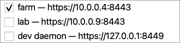
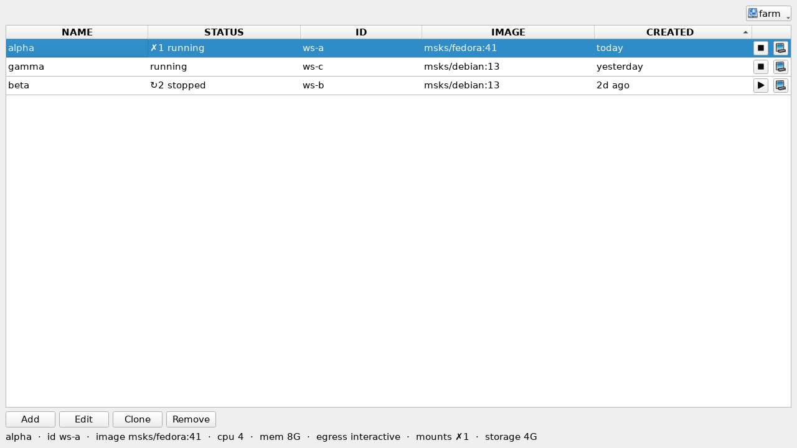
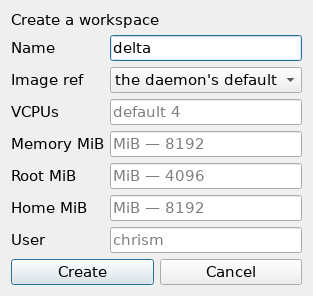
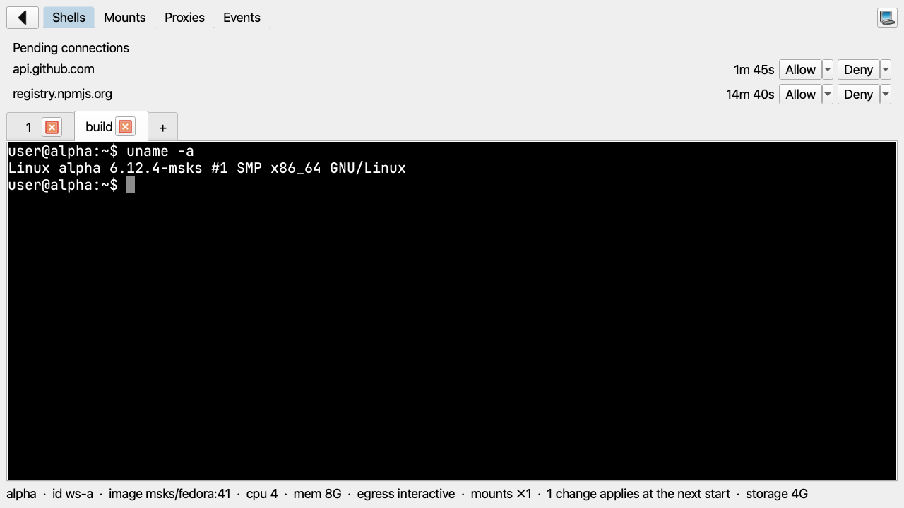
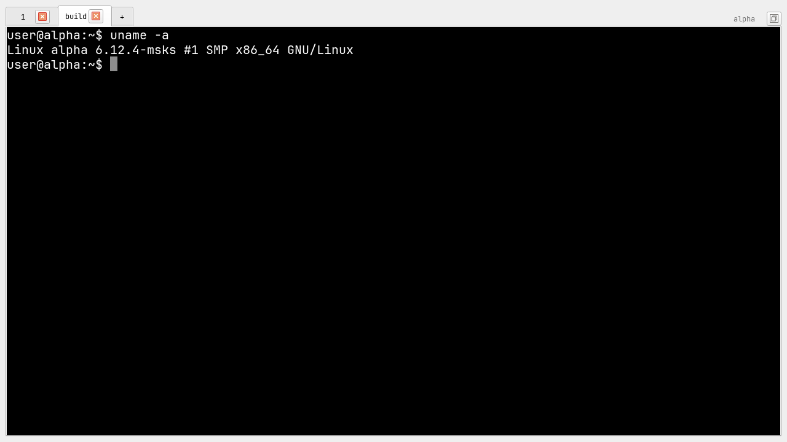
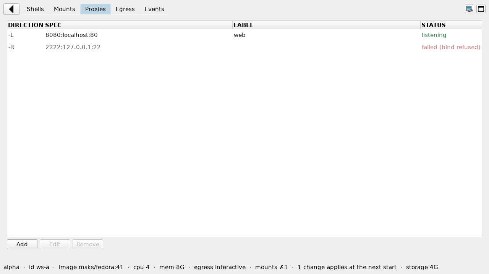
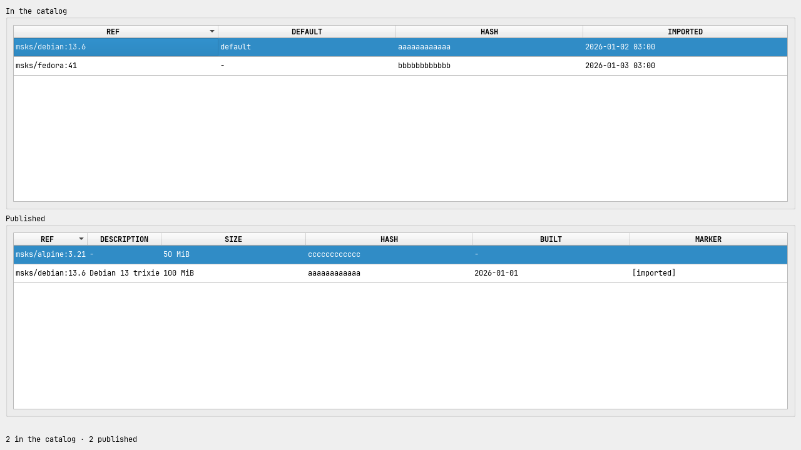
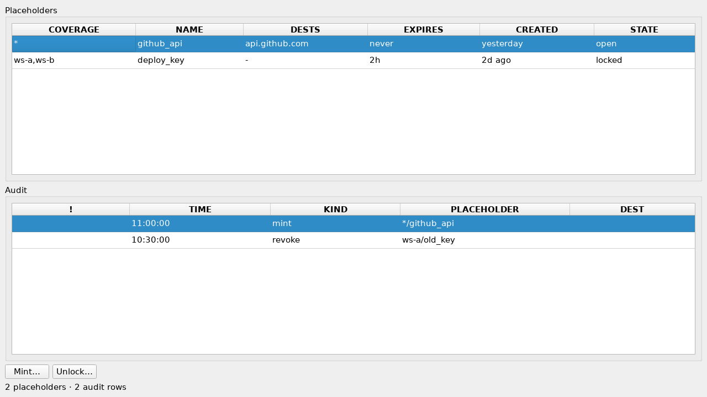

# The GUI

The desktop GUI and the terminal UI are one program: `msks`. The GUI is a
desktop window over the daemon's REST API. It reads the same environment
variables and config file as the TUI and the CLI. It reads no daemon state
directly: every page uses the API.

A bare `msks` (no arguments at all) opens the window, and `msks gui` is the
same command. The TUI has its own command, `msks tui` ([the TUI chapter](tui.md)).

## The connection picker

The list's bottom bar carries the connection picker at its
right end, beside the buttons: the standing daemon's name beside a
menu. The menu lists the config
file's [daemon aliases](cli.md#daemon-aliases) in file order, the
dev daemon's state dir, and the environment's own exports when
they carry an address.

A pick switches the whole window to the picked daemon. The
current screens close and fresh ones open over the new
connection. Shell sessions open on the old connection close with
it.

## The main window

The window opens on four top-level tabs: **Workspaces**,
**Images**, **Secrets**, and **Settings**.

The content appears once it is final. At open and on every tab
change, the page holds clear until its refresh has landed and the
layout is quiet. It then shows at once, and the rows of its tables
rise into place from the top down. The workspace page's own tabs
(Mounts, Proxies, Egress, Events) give their tables the same rise.
A page's live terminals blank for the same spell and repaint when it
shows.

## The workspace list

The **Workspaces** tab opens on the list: one row per workspace,
newest first, in five columns. NAME, STATUS, ID, IMAGE, and
CREATED. A start/stop toggle and a shell button close each row.
The list sits under a **Workspaces** heading, the shape the Images
and Secrets pages use, so the first table of every tab starts at
the same height.

The list re-reads the daemon when the daemon publishes a websocket
event: a workspace changed from another surface (the CLI, another
operator) appears without a click, and a daemon at rest receives
no periodic listing traffic from an open window.

Click a column header to sort by it. CREATED sorts newest first
by default. STATUS sorts in the lifecycle order (created,
starting, running, paused, stopping, stopped, absent, unknown).
A click on the header above the action buttons sorts nothing.

The STATUS cell can carry two markers ahead of the state word.
`✗N` counts the workspace's unresolved mounts, and `↻N` counts
the changes that wait for the next start. The [mounts
chapter](mounts.md) lists every kind of skip. A row with pending
changes spells the count out in its tooltip: `2 changes apply at
the next start`.

A click selects the whole row. A double-click or Enter opens the
workspace's page. The row's toggle starts a stopped workspace or
stops a running one, and a stop asks first. The shell button
opens the workspace's page with a shell in it. A right-click
opens the row's menu: Edit, Start or Stop, Open a shell, Clone,
and Delete. Clone asks for the new workspace's name. Delete asks
for confirmation, and the workspace's data goes with it.

The page's bottom bar carries **Add**, **Edit**, **Clone**, and
**Remove**, then the status line, then the connection picker at the
right end. Add opens the create dialog. Edit, Clone, and Remove
act on the selected row. Clone asks for the new workspace's name
there too, and the clone takes the same route the `msks clone`
command takes: both disks copy under the source's egress mode.
A stopped workspace clones; a running one answers a refusal that
flashes on the status line.

A failed refresh flashes the status line in the bottom bar.
A refusal clears itself after four seconds. A daemon outage
stands on the line until an answer resolves it, and the rows
already on screen stand the whole time. While the daemon is
down, the events feed's retry message flashes over the outage
on every failed connection. The outage's text returns when each
flash ends. A window opened while the daemon is down recovers by
itself when the daemon comes up. The events feed reconnects
within five seconds, and every connection it makes re-reads the
page. The status line then says `daemon back — listing resumed`
once.

The strip at the bottom reads the held row's quick facts: the
name, id, image, cpu count, memory, egress mode, mounts marker,
pending note, and storage cost. The storage figure comes from the
daemon's capacity report. The strip follows the selection, and
an empty list blanks it.

## Creating a workspace

**Add** opens the create dialog over the list, centered on the
window. Name is the only required field. The image picker offers
the daemon's default first, then every catalog ref. Each size
field takes a whole number of MiB. It also takes a size with a
`G`, `GiB`, `M`, or `MiB` suffix: `8G`, `8GiB`, and `8192M` all
mean 8192 MiB, and `0.5G` means 512 MiB. Their placeholders show
the defaults (`default 4G`), and a blank field takes that
default. The user field's placeholder is your own account name.
A line under the fields restates the four sizes as you type, with
the defaults filling the blanks:
`4 vCPU · 8 GiB RAM · 4 GiB root · 8 GiB home`. A decimal entry
shows its resolved size there: `0.5G` shows `512 MiB`. A create
the daemon refuses keeps the dialog standing with the reason on
its note line. A landed create closes the dialog and refreshes
the list, which holds the new workspace on its first row.

You may need to [import an
image](first-run.md#importing-a-guest-vm-image) before the first
create.

**Edit** opens a dialog seeded with the workspace's sizes and
topology: VCPUs, memory, and the root and home volumes. The size
fields take the same forms as the create dialog. Each one opens
with the workspace's current size. `8G`, `1.5G`, and `1000M` are
the usual spellings, and a size those spellings would round opens
in plain MiB (`8193M`). Apply posts to the same endpoint
`msks resize` uses, with the sizes as MiB counts.

## The workspace page

Enter on a row opens the workspace's page. The back arrow (or
Escape) returns to the list. The window's title reads `msks —
alpha` while the page shows: the title bar is where the page's
header lives.

The page's top row holds the back arrow, the tab strip, a status
line, the external-terminal button, and the terminal-only button
at the right end. The tab strip holds **Shells** (the default),
**Mounts**, **Proxies**, **Egress**, and **Events**. The footer strip
at the bottom repeats the list's quick-facts line for this
workspace.

The page re-reads the daemon at its open, when the events
connection serves, and on every move the events feed pushes.
A proxy transition repaints the
Proxies tab without a click, and every frame appends to the
Events tab.

A listing that can no longer see the workspace returns you to
the list, with a notice on the list's status line.

### The Shells tab

The page opens with one shell when the workspace has none. Each
shell is an ssh session in its own terminal subtab, numbered in
open order. The numbers are never reused inside a workspace. The
**+** tab at the strip's right end opens one more shell. A
double-click on a shell tab renames it in place: Return stands
the name, and Escape or an empty edit cancels. Each tab's close
button ends its session.

The same actions have keys, the set Konsole and GNOME Terminal
use. They answer with a terminal focused, and the key itself never
reaches the program inside the terminal. They answer from the
page's other tabs too, and a shell action first brings the Shells
tab forward.

| Key                          | Action                                                  |
| ---------------------------- | ------------------------------------------------------- |
| `Ctrl+Shift+T`               | open a shell                                            |
| `Ctrl+Shift+W`               | close the current shell                                 |
| `Ctrl+Tab`, `Ctrl+Shift+Tab` | the next shell, the previous shell                      |
| `Ctrl+1` to `Ctrl+9`         | the Nth shell                                           |
| `Alt+1` to `Alt+5`           | the page's tab: Shells, Mounts, Proxies, Egress, Events |

The keys belong to the workspace page. A window torn off it answers
the same keys, except `Alt+1` to `Alt+5`, which name the page's tabs.
The Workspaces list and the Images and Secrets pages do not answer
them.

The keys take precedence over the same keys inside the shell. A
program that binds `Ctrl+Tab` or `Alt+1` to `Alt+5`, such as tmux
or WeeChat, does not receive them from the GUI. Bind such a program
to other keys.

The terminal has keys of its own. Linux and Windows spell them
`Ctrl+Shift`, as Konsole and GNOME Terminal do, because plain
`Ctrl+C` is the program's interrupt. macOS spells them with
Command, as Terminal.app and iTerm2 do, and answers the
`Ctrl+Shift` keys as well.

| Key                                         | Action                       |
| ------------------------------------------- | ---------------------------- |
| `Ctrl+Shift+C` (macOS: `Cmd+C`)             | copy the selection           |
| `Ctrl+Shift+V` (macOS: `Cmd+V`)             | paste the clipboard          |
| `Ctrl+Shift+F` (macOS: `Cmd+F`)             | open or close the find bar   |
| `Shift+PgUp`, `Shift+PgDn`                  | page the scrollback          |
| `Ctrl+Click` on a link (macOS: `Cmd+Click`) | open the link in the browser |

`Ctrl+Shift+X` copies on Linux and Windows. `Cmd+X` is not a copy
key on macOS, so the program inside the terminal receives it.

On macOS the Control key is the program's Control key. `Ctrl+C`
inside a terminal is the program's interrupt, as it is on Linux.
The terminal keeps the keys in the table above for itself. The
program inside receives neither the press nor the release.

A right-click opens a menu with Copy and Paste. The menu shows
the keys of the platform.

Output wrapped in a synchronized-output block (mode 2026) holds
its presentation until the block closes. The terminal then
paints the block's whole change once, as the mode specifies.
Your own actions still paint right away: scrolling the buffer,
selecting, resizing, and searching each show the current state
at once. A block that stays open past half a second presents
anyway, so a program wedged inside its own block cannot freeze
the terminal. A program that writes without the mode sees each
chunk painted as it arrives.

A tab shows the title the program inside sets. A program that
sets the terminal's title (vim, less, ssh, or a prompt with an
OSC title in its `PS1`) sets its tab's title too. A long title
ends in an ellipsis, and the tab's tooltip shows the whole
title. When the program clears the title, the tab shows the
number again. A renamed tab keeps its name for the session's
life, whatever the program inside sets.

The sessions outlive the page. Back to the list closes nothing,
and a return visit finds them running the whole time. Closing
the window closes every open shell.

### Tearing a shell off into a window

A left-button drag on a shell tab moves the tab, the way a drag moves
a tab in Firefox. Along the strip, the other tabs make room under the
pointer, and the tab takes its new place when the button is released.
`Ctrl+Tab` follows the new order. A click that does not move the
pointer stays a click. Escape during the drag cancels it, and the tab
returns to where it started.

Drop the tab off every tab strip and it opens as a window of its own,
under the pointer on X11 and macOS. Wayland places new windows itself,
so the window opens where the desktop puts it. The window holds that
shell's terminal in a tab strip of its own, and its title bar shows
the shell's title. The session keeps running through the move. The
tab's close button, the double-click rename, and the shell keys work in
the window, and the **+** tab opens one more shell there. `Ctrl+Tab`
steps among the window's own tabs.

Drop the tab on the tab strip of another window and it becomes a tab
there. The strip shows where the shell will land while the pointer
hovers over it. The other window can be the workspace page or a
window torn off earlier.

The same gestures work on the tab row in terminal-only mode.

### Terminal-only mode

The terminal-only button hides the page's controls and the
window's top-level tab strip. `Ctrl+Shift+M` does the same from
the keyboard, from a terminal too. The window then shows the
shell tabs and the terminal alone, in the layout of a tabbed
terminal app: the tab row on top, the terminal filling the rest.
The mode sets the page's top margin to zero. With no egress hold
waiting, the tab row is then the window's first row, flush under
the title bar. The workspace's name shows in gray at the tab
row's right end, and the restore button follows it. The restore
button keeps the right edge the terminal-only button stood at,
and it rides the tab row. Where the page's top row stood taller
than the tab row, the pointer rests on the terminal, below the
restore button. Leaving the mode by mouse then takes one move of
the pointer. `Ctrl+Shift+M` leaves the mode from anywhere on the
page.

The mode shows the Shells tab when another page tab was current.
The shell tabs, the **+** tab, the rename, the close buttons, and
their keys work as before. The footer row goes with the page's other
controls, the [dictate pill](#dictation) seated in it with them, and
the window's own pill floats at the tab row's right end instead, left
of the restore button. The terminal keeps the window's whole width. So
do the drag gestures: a left-drag
tears a tab off into a window, reorders the tabs, and puts a
torn-off shell back on the row. The consent panel keeps its place
above the terminals while a hold waits. The status line moves to
the tab row. A flash or an outage shows beside the workspace's
name. A long one elides at its width, and the whole text reads in
its tooltip.

The restore button and `Ctrl+Shift+M` bring every control back:
the top-level strip, the page's top row, and the footer. The same
tabs stay current, and no shell closes. The mode also ends when
the page closes, and the top-level strip comes back with it. In
the mode the back arrow is hidden and Escape does not leave the
page. Leave the mode first to leave the page.

### The consent panel

Above the terminals, the consent panel lists the workspace's
pending egress requests while any wait: one row per hold, the
destination, a live countdown, and Allow and Deny buttons. The
main click sends the verdict until restart. The small arrow
beside each button opens the duration menu: `once`, `5m`,
`15m`, `tilrestart`, `forever`. The [egress consent
chapter](egress-consent.md) explains what verdicts cover.

A hold leaves the list the moment the daemon resolves it,
whatever resolved it: a verdict from another decider window, or
the hold's own timeout. The panel hides itself when no hold
waits. A verdict the daemon refuses keeps its row and flashes
the reason on the panel's note line.

The page registers as the workspace's decider while it shows.
While the page is hidden it holds no flows, and another decider
(the TUI's page, `msks-term-popup`) can take the queue.

### The Mounts tab

The tab edits the workspace's host-share mounts. The table reads
the spec beside the state the daemon derived, in five columns:
HOST, GUEST, MODE, STATE, REASON. **Add** opens the form, **Edit**
changes the selected row, and **Remove** drops it. Every change
posts the whole list to the daemon.

A right-click on a row selects it and opens its menu with
**Edit** and **Remove**. The entries take the buttons' own
paths and act on the selection, with the buttons' gating. A
press below the rows opens nothing.

The daemon owns the rules. A host path outside the allowed roots
is refused with the remedy stated, and the refusal appears on
the tab's note line. The edited list rolls back to the last set
the daemon accepted.

A change waits for the next start, and the tab says so in a
standing note while it waits. The [mounts chapter](mounts.md)
describes what a mount is and every kind of skip.

### The Proxies tab

The tab manages the workspace's persisted proxies. The rows read
the direction (local `-L`, remote `-R`), the spec in the CLI's
own grammar, the label, and the live status word with its cause.
**Add** opens the form, and a spec the CLI's parser refuses keeps
the form standing with the rule on its note line. **Edit**
reopens the form seeded with the row. **Remove** asks first.

The listing refreshes after every mutation and on every proxy
transition the events feed pushes. A bind that fails while the
tab stands paints itself without a click. The [proxies
chapter](proxies.md) describes what a proxy is.

### The Egress tab

The tab manages the workspace's egress posture. The top shows
the current mode with its meaning. The switcher under it
changes the mode in place. A running workspace swaps its rules
in one transaction, and a stopped workspace builds the new
posture at its next start. The note line at the bottom says
which one happened.

A switch to `static` with nothing effectively allowed asks a
question first. That posture answers every name NXDOMAIN, so
the workspace would be offline. **Yes** confirms the switch.

The lower half edits the static allowlist. The list reads the
workspace's entries. **Add** opens a one-field form. The entry
is a host, a scope (`.debian.org`, `*.example.com`), an
address, a CIDR, or `host:port`. **Remove** drops the selected
entry. Each write posts the whole new list through the policy
route, and the reply repaints the list.

The daemon owns the entry's shape. An entry the route rejects
appears with the route's reason on the tab's note line, and the
list rolls back to the last set the daemon accepted. Removing
the last entry under `static` asks the same offline question
the mode switch asks. The [egress consent
chapter](egress-consent.md) explains what the modes, the
allowlist, and the verdicts cover.

### The Events tab

The tab is the workspace's recent-events window. Each row is one
frame the daemon published, written as a log line: a local time
stamp, the event kind, and a one-line summary. Rows append
newest last, the window keeps the last twenty, and the tail
stays in view. Long summaries wrap to the next line. The tab
clears at every open of the page.

## The Images tab

The second top-level tab manages the image catalog. **In the
catalog** lists the daemon's own rows with the default marker,
the hash prefix, and the import date. **Published** lists the
channel's rows with their descriptions, sizes, hash prefixes,
and build dates. A published row that declares another
architecture stays off the page. A row that declares none is
shown. A published row whose exact hash the catalog holds reads
`[imported]`. One the catalog holds under a different hash reads
`[local]`.

Each group carries a button row under its table. The buttons act
on the selected row of their group, and each button stands
disabled until a row is selected. Under **In the catalog**,
Details… opens the selected image's record, which holds the same
lines `msks image info` prints. Enter on a catalog row opens the
record too. Set as the default posts the designation at once.
Remove… asks first. Under **Published**, Import… runs behind a
progress dialog while the daemon downloads, verifies, and
floor-checks the archive. The catalog refreshes when the import
lands.

A right-click on a row opens the same actions as a menu: Open
the detail, Set as the default, and Remove… on a catalog row, and
Import… on a published row.

The counts line at the page's bottom tallies both sides. The
[images chapter](images.md) describes the catalog and the
channel.

The page re-reads itself. It re-reads at every show, and the
daemon's pushed `image.changed` frame re-reads the catalog
group while the tab is open: an import, rename, or removal from
any attached client repaints the page. The published group is
the channel's manifest, which the client fetches itself. The
channel publishes no frame, so its rows move only through the
page's re-reads.

A dropped events feed flashes the page while it is open. The
page re-reads whole when the feed serves again, so the gap
between the drop and the recovery lands on screen. A daemon
outage keeps its text on the status line between the feed's
retry flashes. The first answered read after it says
`daemon back — images resumed` once. An action's answer also ends
the outage. The status line shows the action's result, not the
recovery line.

## The Secrets tab

The third top-level tab manages the daemon's secret
placeholders. The **Placeholders** group lists every row with its
coverage, name, destinations, expiry, created label, and lock
state. The COVERAGE cell uses the words the mint form's coverage
picker uses. A row that every accepting workspace honors reads
`daemon-wide`. A row that serves picked workspaces reads
`scoped: ws-a, ws-b`. The COVERAGE header carries both meanings
as its tooltip. The EXPIRES cell is a live countdown with the
deadline's clock beside it. `2h · 14:20` means the row expires in
two hours, at 14:20 local time. The countdown repaints every
second and the clock stands still. The cell's tooltip shows the
full local date and time of the deadline. An unbounded row reads
`never`.

**Renew…** and **Revoke…** sit on the button row beside Mint and
Unlock. Both stay disabled until a placeholder row is selected,
and both stay disabled while a renew or a revoke is in flight.
Renew… opens the TTL picker (`1h` to `30d`, with the choice
nearest the row's remaining lifetime pre-selected). Revoke… asks
first. A revoked row retires everywhere at once. A right-click
on a row opens a menu with the same two actions.

**Mint** opens the mint form: name, comma-separated destinations,
coverage (`daemon-wide`, or `scoped` with a workspace
multi-select), the TTL choice, and the value. A landed mint
closes the form and the listing refreshes. The GUI shows no
sentinel panel: the flash reports the minted row, and the
sentinel itself reads back through the CLI or the TUI. The
[secrets chapter](secrets.md) explains placeholders and sentinels.

**Unlock** runs the secrets unlock against the daemon's locked rows,
the TUI's `u` action as a button. An encrypted key file opens a
masked passphrase dialog centered on the window. The typed
passphrase loads the key, and every row the key opens uploads.
The outcome shows on the tab's status line, and the daemon's
unlock frame re-reads the listing behind it. The window also
offers the unlock on its own when it opens and after a connection
pick. The prompt is the window's one per session. The outcome lands
on the workspaces list's status line, and the button asks again by
hand. See the [secrets chapter](secrets.md#the-clients-half).

The **Audit** group beneath lists the daemon's recorded secret
events, newest first. The daemon records four kinds of rows:
mint, revoke, expiry, and unlock. A renew changes a row's
deadline without recording an audit row. The table has four
columns: TIME, KIND, PLACEHOLDER, and DEST. The TIME cell shows
the row's local clock. A row from an earlier day carries its
date beside the clock. PLACEHOLDER reads `*/name` for a
daemon-wide row and `ws-a/name` for a scoped one. A sighting (a
placeholder token that reached a host its mint did not allow) is
a live event. It streams into the TUI's audit view and does not
appear in this table.

The page re-reads itself. It re-reads at every show and behind
every action, and the daemon's pushed secret frames re-read it
while the tab is open: a mint, revoke, unlock, or expiry from
any attached client repaints both groups. A workspace reading
its placeholders pushes a frame per request, so the page
batches frames behind half a second and takes one re-read per
batch.

A dropped events feed flashes the page while it is open. The
page re-reads whole when the feed serves again, so the gap
between the drop and the recovery lands on screen. A daemon
outage keeps its text on the status line between the feed's
retry flashes. The first answered read after it says
`daemon back — secrets resumed` once. An action's answer also ends
the outage. The status line shows the action's result, not the
recovery line.

## Dictation

A small pill sits on every page of the main window and on each
torn-off shell window. It is the same control everywhere, and one
recording runs behind all of them. On each page it sits at the right
end of the page's own bottom row: beside the quick facts on the
workspace list, where the connection picker stands above it, the
counts on Images and Secrets, the status line on Settings, and the
footer on a workspace page. The workspace page's terminal-only mode
hides its footer, and the pill then floats at the tab row's right
end, left of the restore button. Dialogs carry no pill. Click it to start talking. Click it
again to finish. Nothing ends a recording on your behalf: a pause
inside a sentence is not the end of one. A three-minute cap ends a
clip that nobody stopped.

The transcript goes to the clipboard and to the primary selection.
You paste it where you want it. A tone plays when the recording
starts and another when the text is on the clipboard. A desktop
notification carries the first line of the transcript. When every
window is minimized, the tones and the notification are the only
sign that a recording is running.

The pill changes with the recording:

- Idle: a microphone glyph in the window's own text color.
- Recording: the glyph in red, a timer (`● 0:12`), and a small
  `x`. A click finishes the recording. The `x` discards the clip.
- Transcribing: an ellipsis in place of the timer. A click abandons
  the transcript and starts a new recording. The `x` discards it.
- Done: `copied` for two seconds. Failed: the reason for four
  seconds, and the notification carries it too.
- No model yet: a download glyph. A click opens the **Settings**
  tab.

The recorder finds speech against the room's noise floor, and keeps
the half second before the speech starts so the first word survives.
The level that counts as speech sits 14 dB above the tracked floor
(the 10th percentile of the last three seconds) and never below -60
dBFS. The first 0.3 seconds calibrate the floor, so start talking
after the tone. A speakerphone's floor in a quiet room sits near -33
dBFS, and a fixed level would take the room itself for speech. A
clip with no speech in it ends with no transcript and no tone.

Capture runs on the host because a workspace guest has no audio
device. `pw-record` captures 16 kHz mono, and `whisper-cli` (from
whisper.cpp) transcribes the clip once it ends. The model loads for
each clip, which takes about one second with `small`. The model is
not shipped: the first click opens the **Settings** tab, whose
**Download** button fetches it into `~/.cache/msks/whisper/`. The
[CLI chapter](cli.md#the-gui-preferences-file) describes the
settings, their file, and the precedence.

On a Mac the same calls answer through the shims that
`msks-setup-macos-host` lands (#1216). `pw-record` captures through
ffmpeg's avfoundation, `pw-cat` plays through `afplay`, and
`notify-send` shows the notification through `osascript`. The run
brews `whisper-cli` and `ffmpeg`. The first recording asks macOS for
the microphone. The prompt shows the name of the terminal that
launched the GUI. The capture device is the desktop's default input,
and the Device setting below selects another one by its avfoundation
index. `PW_RECORD_AUDIO_INDEX` overrides the setting for one launch.

## The Settings tab

The fourth tab edits the dictation settings. The form shows the
settings in effect now, and every field takes a change.

- **Model**: a whisper.cpp ggml model. The picker lists the known
  names with their sizes, and a path to a `.bin` file types free.
  A NixOS host can pin a model as a derivation and type its store
  path. A larger model transcribes more accurately and loads more
  slowly at each clip: about a second with `small`, two to three
  with `large-v3-turbo`.
- **Device**: the microphone `pw-record` captures from. On Linux it
  is a PipeWire source: the picker lists the sources the desktop
  serves, **Refresh** reads the list again, and the default input
  follows the desktop's own choice. A node name or serial typed free
  selects one the list does not carry. On macOS the picker holds the
  default input alone, and a number typed free selects the
  avfoundation input with that index. The default input follows the
  desktop's choice there too.
- **Vocabulary prompt**: the words whisper-cli biases its spelling
  toward, such as `msks, devenv, NixOS, pi`. Leave it empty for
  plain dictation.

Hover a setting's name or its field for its description. A key that
an `MSKSC_DICTATE_*` variable pins shows the variable's value in a
read-only field, with the variable named under the form.

**Apply** saves the fields into `~/.config/msks/gui.yaml` and the
next recording takes them. A recording ends at the pill's second
click, whatever the settings. **Apply** and **Revert** stand dark
while the fields match the saved settings, and light at the first
change. **Revert** reads the layers again and reseeds the fields. A value that refused anywhere shows its message
under the form, and the setting reads as its default.

**Speech model** shows where the picked model points and whether
it is on disk, with its size; the line follows the picker as it
changes. **Download** fetches a missing model into the cache with a
progress bar and makes it the configured model, and **Cancel**
abandons the download. A path setting downloads nothing, and the
line says so.

## The zoom keys

Ctrl+Plus, Ctrl+=, and Ctrl+Shift++ (the plus key without a
numpad) all grow every font in the client one step. Ctrl+Minus
shrinks them. Ctrl+0 puts both font sets back to their defaults.
The keys answer wherever the focus stands, on any screen.

Both font sets move together: the window's chrome and every live
terminal. Each set stops at its own clamp, and one still moves
while the other stands at its clamp. A shell opened after a zoom
joins the standing size, and the zoom survives a connection
switch.

## The external-terminal launcher

The workspace page's top-right button opens a workspace shell in
an external terminal window. The launcher comes from the
`terminal_open_cmd` client setting, the same one the TUI's
windowed shell action uses. [The TUI
chapter](tui.md#terminal_open_cmd) documents the string and list
forms and the terminal examples.

Without a configured launcher the button flashes a notice and
opens nothing: the GUI has no terminal of its own to hand the
session. A configured launcher starts detached with the `msks
ssh` invocation appended, beside the running window, and the
flash reports whether it started.

## Light and dark palettes

The window follows the desktop's color scheme. A light desktop
paints the chrome light, and a dark one paints it dark. A scheme
switch mid-session repaints the window live, with no restart.

The terminal grids switch with the chrome. A program inside a
terminal that sets its own colors keeps winning over the theme.
A desktop that states no scheme keeps the palette the platform
handed the window.

### State colors

A state word wears one of three colors beside its text, in both
palettes. Green means the state is as it should be: a running
workspace, a mount the last start attached, a listening proxy
the guest can reach, an open secret. Amber means the state is in
flight or wants a look: a workspace that is starting, stopping,
or paused, a row with unresolved mounts or changes that wait for
the next start, a skipped mount, a proxy that listens but whose
guest cannot reach it, a locked secret, and a secret that
expires within fifteen minutes. Red means something failed or
cannot be placed: an absent or unknown workspace, a failed
proxy, a refused call or an outage on a status line, and a
consent request in its last fifteen seconds.

The word stays in the cell, so a color-blind reader and a
grayscale screenshot keep the same information. A selected row
keeps the highlight's own text color, and a disabled row keeps
its dimmed text. Each color meets a 4.5:1 contrast ratio against
every background it paints on, and a scheme switch repaints the
colors with the rest of the window.

## Environment, icons and scaling

The window needs a display. A Linux session provides one through
`DISPLAY` or `WAYLAND_DISPLAY`, and `QT_QPA_PLATFORM=offscreen`
also works. A start that finds no display prints one line on
stderr and exits. The line names `msks tui`, which opens the TUI in
the same terminal. [Dictation](#dictation) needs four host tools
the window itself does not: PipeWire's `pw-record` and `pw-cat`
(capture and the tones), whisper.cpp's `whisper-cli` (the
transcription), and `notify-send` for the desktop notification.
The pill shows the missing tool's name when a recording fails
without one, and the tones and the notification stay off on a host
without theirs. The packages carry the tools under their own
names: `pw-record` and `pw-cat` ship with PipeWire, `whisper-cli`
with whisper.cpp (`whisper-cpp` on NixOS), and `notify-send` with
libnotify. The transcript reaches the clipboard through Qt, so
no clipboard helper is needed. A macOS session needs a desktop login. The
window opens fine over ssh while one stands.

The window plants its own desktop entry and taskbar icon on a
Linux desktop. Every launch of the window (`msks gui` or a bare
`msks`) installs both under the
XDG data home before the window opens. The taskbar shows the
msks icon from the first launch after a fresh install, and the
next launch after an upgrade refreshes the icon renders. When
the install fails, msks prints one line on stderr and the
window still opens. `msks gui-shortcut` does the same work by
hand and prints the entry's path. On macOS nothing is planted.
The dock reads the icon the window itself already carries.

Uninstalling the wheel leaves the entry and the icons in
place, because they live in the XDG data home, outside the
wheel's tree. Delete `~/.local/share/applications/msks.desktop`
and the `msks.*` files under `~/.local/share/icons/hicolor` to
remove them by hand.

The window opens 1280 by 720 the first time. Every later open
takes back the place and size the last close left, as long as a
connected screen still shows some of that rect.

`MSKSC_GUI_FONT_SCALE` multiplies the window's base font size.
The base is 15 logical pixels, the size the terminal face's
15pt default rasterizes to on macOS. A Linux session rasterizes
a point size larger (96 against 72 font dpi), so the window
anchors its chrome in pixels and converts through the screen's
own dpi: the chrome opens at the same size on every platform
(#1056). The terminal content keeps its own 15pt default, so
it opens larger than the chrome on a 96-dpi session. The
default multiplier is 1.0. The [zoom
keys](#the-zoom-keys) change both sizes at runtime.

## The macOS menu bar

On macOS the window adds the platform's menu bar with the two
standard roles. About opens a dialog with the client's name and
version. Quit (Cmd+Q) closes through the window's own quit path,
the one that closes every open shell. Other platforms keep the
window they have.
