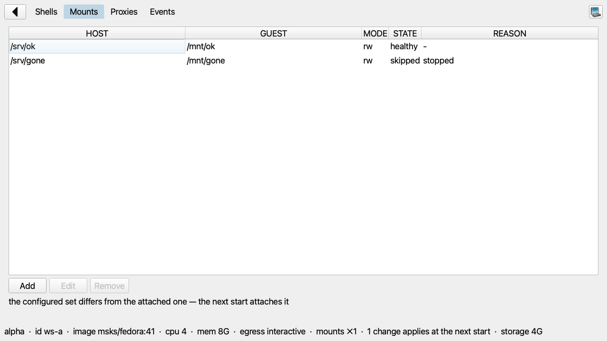
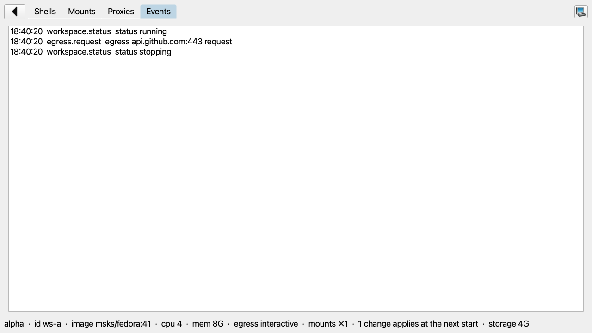

# The GUI

The desktop GUI and the terminal UI are one program: `msks`. The GUI is a
desktop window over the daemon's REST API. It reads the same environment
variables and config file as the TUI and the CLI. It reads no daemon state
directly: every page uses the API.

`msks gui` opens the window.

## The connection picker

The status row's right end carries the connection picker: the
standing daemon's name beside a menu. The menu lists the config
file's [daemon aliases](cli.md#daemon-aliases) in file order, the
dev daemon's state dir, and the environment's own exports when
they carry an address.

A pick switches the whole window to the picked daemon. The
current screens close and fresh ones open over the new
connection. Shell sessions open on the old connection close with
it.

## The main window

The window opens on three top-level tabs: **Workspaces**,
**Images**, and **Secrets**.

## The workspace list

The **Workspaces** tab opens on the list: one row per workspace,
newest first, in five columns. NAME, STATUS, ID, IMAGE, and
CREATED. A start/stop toggle and a shell button close each row.

The list re-reads the daemon when the daemon publishes a websocket
event: a workspace changed from another surface (the CLI, another
operator) appears without a click, and a daemon at rest receives
no periodic listing traffic from an open window.

Click a column header to sort by it. CREATED sorts newest first
by default. STATUS sorts in the lifecycle order (created,
starting, running, paused, stopping, stopped, absent, unknown).
A click on the header above the action buttons sorts nothing.

The STATUS cell can carry two markers ahead of the state word.
`✗N` counts the workspace's unresolved mounts, and `↻N` counts
the changes that wait for the next start. The [mounts
chapter](mounts.md) lists every kind of skip. A row with pending
changes spells the count out in its tooltip: `2 changes apply at
the next start`.

A click selects the whole row. A double-click or Enter opens the
workspace's page. The row's toggle starts a stopped workspace or
stops a running one, and a stop asks first. The shell button
opens the workspace's page with a shell in it. A right-click
opens the row's menu: Edit, Start or Stop, Open a shell, Clone,
and Delete. Clone asks for the new workspace's name. Delete asks
for confirmation, and the workspace's data goes with it.

The page's bottom row carries **Add**, **Edit**, **Clone**, and
**Remove**. Add opens the create dialog. Edit, Clone, and Remove
act on the selected row. Clone asks for the new workspace's name
there too, and the clone takes the same route the `msks clone`
command takes: both disks copy under the source's egress mode.
A stopped workspace clones; a running one answers a refusal that
flashes on the status line.

A failed refresh flashes the status line at the top of the page.
A refusal clears itself after four seconds. A daemon outage
stands on the line until an answer resolves it, and the rows
already on screen stand the whole time. A window opened while
the daemon is down recovers by itself when the daemon comes
up. The events feed reconnects within five seconds, and every
connection it makes re-reads the page. The status line then
says `daemon back — listing resumed` once.

The strip at the bottom reads the held row's quick facts: the
name, id, image, cpu count, memory, egress mode, mounts marker,
pending note, and storage cost. The storage figure comes from the
daemon's capacity report. The strip follows the selection, and
an empty list blanks it.

## Creating a workspace

**Add** opens the create dialog over the list, centered on the
window. Name is the only required field. The image picker offers
the daemon's default first, then every catalog ref. The size
fields show the daemon's defaults in their placeholders, and a
blank field takes that default. The user field's placeholder is
your own account name. A create the daemon refuses keeps the
dialog standing with the reason on its note line. A landed
create closes the dialog and refreshes the list, which holds the
new workspace on its first row.

You may need to [import an
image](first-run.md#importing-a-guest-vm-image) before the first
create.

**Edit** opens a dialog seeded with the workspace's sizes and
topology: VCPUs, memory, and the root and home volumes. Apply
posts to the same endpoint `msks resize` uses.

## The workspace page

Enter on a row opens the workspace's page. The back arrow (or
Escape) returns to the list. The window's title reads `msks —
alpha` while the page shows: the title bar is where the page's
header lives.

The page's top row holds the back arrow, the tab strip, a status
line, and the external-terminal button at the right end. The tab
strip holds **Shells** (the default), **Mounts**, **Proxies**,
**Egress**, and **Events**. The footer strip at the bottom repeats
the list's quick-facts line for this workspace.

The page re-reads the daemon at its open, when the events
connection serves, and on every move the events feed pushes.
A proxy transition repaints the
Proxies tab without a click, and every frame appends to the
Events tab.

A listing that can no longer see the workspace returns you to
the list, with a notice on the list's status line.

### The Shells tab

The page opens with one shell when the workspace has none. Each
shell is an ssh session in its own terminal subtab, numbered in
open order. The numbers are never reused inside a workspace. The
**+** tab at the strip's right end opens one more shell. A
double-click on a shell tab renames it in place: Return stands
the name, and Escape or an empty edit cancels. Each tab's close
button ends its session.

The sessions outlive the page. Back to the list closes nothing,
and a return visit finds them running the whole time. Closing
the window closes every open shell.

### The consent panel

Above the terminals, the consent panel lists the workspace's
pending egress requests while any wait: one row per hold, the
destination, a live countdown, and Allow and Deny buttons. The
main click sends the verdict until restart. The small arrow
beside each button opens the duration menu: `once`, `5m`,
`15m`, `tilrestart`, `forever`. The [egress consent
chapter](egress-consent.md) explains what verdicts cover.

A hold leaves the list the moment the daemon resolves it,
whatever resolved it: a verdict from another decider window, or
the hold's own timeout. The panel hides itself when no hold
waits. A verdict the daemon refuses keeps its row and flashes
the reason on the panel's note line.

The page registers as the workspace's decider while it shows.
While the page is hidden it holds no flows, and another decider
(the TUI's page, `msks-term-popup`) can take the queue.

### The Mounts tab

The tab edits the workspace's host-share mounts. The table reads
the spec beside the state the daemon derived, in five columns:
HOST, GUEST, MODE, STATE, REASON. **Add** opens the form, **Edit**
changes the selected row, and **Remove** drops it. Every change
posts the whole list to the daemon.

A right-click on a row selects it and opens its menu with
**Edit** and **Remove**. The entries take the buttons' own
paths and act on the selection, with the buttons' gating. A
press below the rows opens nothing.

The daemon owns the rules. A host path outside the allowed roots
is refused with the remedy stated, and the refusal appears on
the tab's note line. The edited list rolls back to the last set
the daemon accepted.

A change waits for the next start, and the tab says so in a
standing note while it waits. The [mounts chapter](mounts.md)
describes what a mount is and every kind of skip.

### The Proxies tab

The tab manages the workspace's persisted proxies. The rows read
the direction (local `-L`, remote `-R`), the spec in the CLI's
own grammar, the label, and the live status word with its cause.
**Add** opens the form, and a spec the CLI's parser refuses keeps
the form standing with the rule on its note line. **Edit**
reopens the form seeded with the row. **Remove** asks first.

The listing refreshes after every mutation and on every proxy
transition the events feed pushes. A bind that fails while the
tab stands paints itself without a click. The [proxies
chapter](proxies.md) describes what a proxy is.

### The Egress tab

The tab manages the workspace's egress posture. The top shows
the current mode with its meaning. The switcher under it
changes the mode in place. A running workspace swaps its rules
in one transaction, and a stopped workspace builds the new
posture at its next start. The note line at the bottom says
which one happened.

A switch to `static` with nothing effectively allowed asks a
question first. That posture answers every name NXDOMAIN, so
the workspace would be offline. **Yes** confirms the switch.

The lower half edits the static allowlist. The list reads the
workspace's entries. **Add** opens a one-field form. The entry
is a host, a scope (`.debian.org`, `*.example.com`), an
address, a CIDR, or `host:port`. **Remove** drops the selected
entry. Each write posts the whole new list through the policy
route, and the reply repaints the list.

The daemon owns the entry's shape. An entry the route rejects
appears with the route's reason on the tab's note line, and the
list rolls back to the last set the daemon accepted. Removing
the last entry under `static` asks the same offline question
the mode switch asks. The [egress consent
chapter](egress-consent.md) explains what the modes, the
allowlist, and the verdicts cover.

### The Events tab

The tab is the workspace's recent-events window. Each row is one
frame the daemon published, written as a log line: a local time
stamp, the event kind, and a one-line summary. Rows append
newest last, the window keeps the last twenty, and the tail
stays in view. Long summaries wrap to the next line. The tab
clears at every open of the page.

## The Images tab

The second top-level tab manages the image catalog. **In the
catalog** lists the daemon's own rows with the default marker,
the hash prefix, and the import date. **Published** lists the
channel's rows with their descriptions, sizes, hash prefixes,
and build dates. A published row that declares another
architecture stays off the page. A row that declares none is
shown. A published row whose exact hash the catalog holds reads
`[imported]`. One the catalog holds under a different hash reads
`[local]`.

A right-click on a catalog row opens its menu: Open the detail
(the same lines `msks image info` prints), Set as the default,
and Remove… (which asks first). A right-click on a published row
offers Import…, which runs behind a progress dialog while the
daemon downloads, verifies, and floor-checks the archive. The
catalog refreshes when the import lands.

The counts line at the page's bottom tallies both sides. The
[images chapter](images.md) describes the catalog and the
channel.

The page re-reads itself. It re-reads at every show, and the
daemon's pushed `image.changed` frame re-reads the catalog
group while the tab is open: an import, rename, or removal from
any attached client repaints the page. The published group is
the channel's manifest, which the client fetches itself. The
channel publishes no frame, so its rows move only through the
page's re-reads.

A dropped events feed flashes the page while it is open. The
page re-reads whole when the feed serves again, so the gap
between the drop and the recovery lands on screen.

## The Secrets tab

The third top-level tab manages the daemon's secret
placeholders. The **Placeholders** group lists every row with its
coverage (the owner-wide `*` or its workspace ids), name,
destinations, remaining lifetime, created label, and lock state.
The lifetime cell is a live countdown, repainted every second.
An unbounded row reads `never`.

A right-click on a row opens Renew…, with the TTL choices (`1h`
to `30d`, the one nearest the row's remaining lifetime
pre-selected), and Revoke…, which asks first. A revoked row
retires everywhere at once.

**Mint** opens the mint form: name, comma-separated destinations,
coverage (owner-wide, or scoped to a workspace multi-select),
the TTL choice, and the value. A landed mint closes the form and
the listing refreshes. The GUI shows no sentinel panel: the flash
reports the minted row, and the sentinel itself reads back
through the CLI or the TUI. The [secrets chapter](secrets.md)
explains placeholders and sentinels.

The **Audit** group beneath lists the daemon's recorded secret
events, newest first: mint, revoke, expiry, and unlock rows. A
renew changes a row's deadline without recording an audit row.
The TIME cell shows the row's local clock. A row from an
earlier day carries its date beside the clock. The `!` column
marks a sighting: a placeholder token that reached a host its
mint did not allow, the exfiltration signal. The daemon's
recorded rows are the four lifecycle kinds, so this table's
marker column stays blank. A sighting streams into the TUI's
audit view live. The column's header carries that meaning as
its tooltip.

The page re-reads itself. It re-reads at every show and behind
every action, and the daemon's pushed secret frames re-read it
while the tab is open: a mint, revoke, unlock, or expiry from
any attached client repaints both groups. A workspace reading
its placeholders pushes a frame per request, so the page
batches frames behind half a second and takes one re-read per
batch.

A dropped events feed flashes the page while it is open. The
page re-reads whole when the feed serves again, so the gap
between the drop and the recovery lands on screen.

## The zoom keys

Ctrl+Plus, Ctrl+=, and Ctrl+Shift++ (the plus key without a
numpad) all grow every font in the client one step. Ctrl+Minus
shrinks them. Ctrl+0 puts both font sets back to their defaults.
The keys answer wherever the focus stands, on any screen.

Both font sets move together: the window's chrome and every live
terminal. Each set stops at its own clamp, and one still moves
while the other stands at its clamp. A shell opened after a zoom
joins the standing size, and the zoom survives a connection
switch.

## The external-terminal launcher

The workspace page's top-right button opens a workspace shell in
an external terminal window. The launcher comes from the
`terminal_open_cmd` client setting, the same one the TUI's
windowed shell action uses. [The TUI
chapter](tui.md#terminal_open_cmd) documents the string and list
forms and the terminal examples.

Without a configured launcher the button flashes a notice and
opens nothing: the GUI has no terminal of its own to hand the
session. A configured launcher starts detached with the `msks
ssh` invocation appended, beside the running window, and the
flash reports whether it started.

## Light and dark palettes

The window follows the desktop's color scheme. A light desktop
paints the chrome light, and a dark one paints it dark. A scheme
switch mid-session repaints the window live, with no restart.

The terminal grids switch with the chrome. A program inside a
terminal that sets its own colors keeps winning over the theme.
A desktop that states no scheme keeps the palette the platform
handed the window.

## Environment, icons and scaling

The window needs a display. A Linux session provides one through
`DISPLAY` or `WAYLAND_DISPLAY`, and `QT_QPA_PLATFORM=offscreen`
also works. A start that finds no display prints one line on
stderr and exits. A macOS session needs a desktop login. The
window opens fine over ssh while one stands.

The window plants its own desktop entry and taskbar icon on a
Linux desktop. Every `msks gui` launch installs both under the
XDG data home before the window opens. The taskbar shows the
msks icon from the first launch after a fresh install, and the
next launch after an upgrade refreshes the icon renders. When
the install fails, msks prints one line on stderr and the
window still opens. `msks gui-shortcut` does the same work by
hand and prints the entry's path. On macOS nothing is planted.
The dock reads the icon the window itself already carries.

Uninstalling the wheel leaves the entry and the icons in
place, because they live in the XDG data home, outside the
wheel's tree. Delete `~/.local/share/applications/msks.desktop`
and the `msks.*` files under `~/.local/share/icons/hicolor` to
remove them by hand.

The window opens 1280 by 720 the first time. Every later open
takes back the place and size the last close left, as long as a
connected screen still shows some of that rect.

`MSKSC_GUI_FONT_SCALE` multiplies the window's base font size.
The base is 15 logical pixels, the size the terminal face's
15pt default rasterizes to on macOS. A Linux session rasterizes
a point size larger (96 against 72 font dpi), so the window
anchors its chrome in pixels and converts through the screen's
own dpi: the chrome opens at the same size on every platform
(#1056). The terminal content keeps its own 15pt default, so
it opens larger than the chrome on a 96-dpi session. The
default multiplier is 1.0. The [zoom
keys](#the-zoom-keys) change both sizes at runtime.

## The macOS menu bar

On macOS the window adds the platform's menu bar with the two
standard roles. About opens a dialog with the client's name and
version. Quit (Cmd+Q) closes through the window's own quit path,
the one that closes every open shell. Other platforms keep the
window they have.
