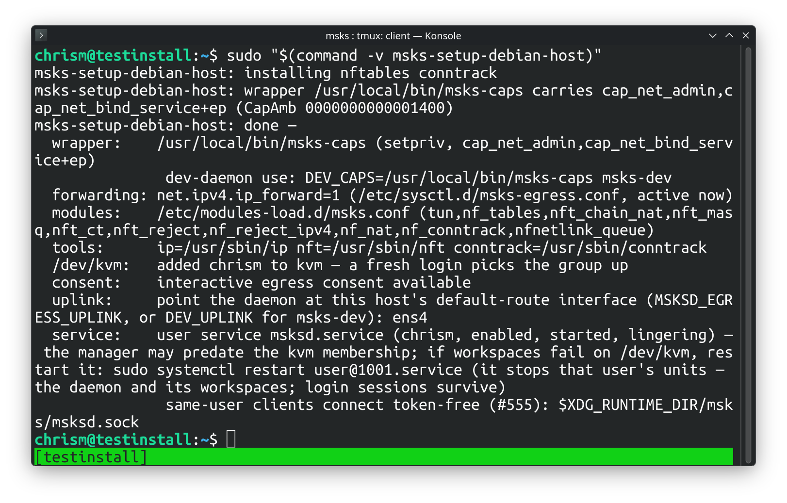

# Installation

msks ships as a Python distribution with everything inside: the client
(`msks`), the daemon (`msksd`), the consent-decider terminal
(`msks-term-popup`), and the host setup tools this chapter describes
(`msks-setup-debian-host`, `msks-setup-fedora-host`, and
`msks-setup-macos-host`).

The wheel needs Python 3.14 or newer. A stock Debian or Fedora host
holds no 3.14, so the installer provisions its own interpreter (see
below). The script needs `curl` and `tar` on the host. Beyond that,
nothing needs installing first.

## The one-command install

Every release carries two bootstrap scripts, one per platform family.
The script is the whole installer: it fetches the release's artifacts,
verifies them, and runs the platform setup tool.

A NixOS host installs from the flake instead. The [NixOS hosts](#nixos-hosts)
section below describes that install.

Debian-derived hosts (Debian, Ubuntu 24.04 or newer, Linux Mint 22
or newer):

```console
curl -LsSf https://github.com/mcdonc/msks/releases/latest/download/msks-setup-debian.sh | sudo sh
```

Fedora-derived hosts:

```console
curl -LsSf https://github.com/mcdonc/msks/releases/latest/download/msks-setup-fedora.sh | sudo sh
```

Run the command as the user the daemon will serve. That account is the
executing user throughout (the `SUDO_USER` under sudo): the `msks`
group grant, the `kvm` membership, and the login PATH block all land
on it.

What the script does, in order:

1. It downloads the release's checksum record (`SHASUMS`) and the
   platform wheel. Every artifact it fetches is verified against the
   record before use, and a checksum mismatch stops the install.
2. It downloads Cloud Hypervisor's static release binary, verified the
   same way, and installs it at `/usr/local/bin/cloud-hypervisor`. A
   `cloud-hypervisor` already on PATH stays untouched.
3. It provisions `uv` when the host holds none, then a uv-managed
   Python 3.14 under `/opt/msks/python`.
4. It builds a throwaway venv from the verified wheel and runs the
   platform setup tool from it as root, passing the verified wheel
   along. The throwaway venv is discarded when the tool exits. The
   tool lands the real install, `/opt/msks/venv`, from those exact
   bytes.

The trust profile is unchanged: shipped code over TLS plus pinned
checksums, and nothing stronger. The [by-hand
chapter](#the-same-install-by-hand) spells out every step.

Flags after `-s --` reach the tool:

```console
curl -LsSf https://github.com/mcdonc/msks/releases/latest/download/msks-setup-debian.sh | sudo sh -s -- --no-service
```

`--wheel <path>` installs a wheel in hand: only the wheel fetch is
skipped (the checksum record still downloads, for the VMM and uv
pins). `--uninstall` reverses the install (see [Uninstalling
msks](#uninstalling-msks)).

The three download bases answer to environment overrides for mirrors:
`MSKS_RELEASE_URL`, `MSKS_VMM_URL`, and `MSKS_UV_URL`.

The run is idempotent: re-run any time. Re-run after a util-linux
upgrade too (the wrapper keeps a copy of `setpriv`; see below).



You will need to log out and back in for `msksd doctor` to return
clean after the run.

## NixOS hosts

A NixOS host gets the whole install from the flake at
`github:mcdonc/msks`. Add the flake as an input, import the module, and
enable the service:

```nix
{
  inputs.msks.url = "github:mcdonc/msks";

  outputs = { self, nixpkgs, msks }: {
    nixosConfigurations.myhost = nixpkgs.lib.nixosSystem {
      system = "x86_64-linux";
      modules = [
        msks.nixosModules.msks
        {
          services.msksd.enable = true;
          services.msksd.egress.uplink = "eno4"; # ip route show default
        }
      ];
    };
  };
}
```

`egress.uplink` is the interface workspace egress masquerades out of.
Set it to the host's default-route interface. `ip route show default`
prints it. The module requires a value while egress is enabled (the
default). A wrong interface installs cleanly and NAT matches nothing.
That failure mode is why the module refuses to guess.

Importing the module alone installs nothing. All of its host
configuration applies only when `services.msksd.enable` is set.

Setting `enable = true` does five things:

- **The binaries on PATH.** The msks console scripts (`msks`, `msksd`,
  `msks-term-popup`, the `msks-setup-*` tools) go on the system PATH for
  every user of the host. They are the same derivation the service unit
  runs.
- **The service.** `msksd.service` starts at boot as the dedicated
  `msksd` system user. The user reaches `/dev/kvm` through the `kvm`
  group.
- **The TCP listener.** The daemon serves its API on HTTPS + WSS at
  `listenAddress:port` (the default `127.0.0.1:8660`), with TLS and
  bearer tokens.
- **The settings files.** The module generates `msksd.yaml` into the nix
  store at build time, with every tool path pointing into the store, and
  the host's client config at `/etc/msks/msks.yaml`. Every login session
  gets `MSKSC_CONFIG_DIR=/etc/msks`, so a bare `msks` reads that file.
  Both files take more keys through `services.msksd.server.settings`
  and `services.msksd.client.settings`. See [Every daemon key, and the
  host's client config](#every-daemon-key-and-the-hosts-client-config).
- **The egress stack.** With egress enabled the unit carries ambient
  `CAP_NET_ADMIN` and `CAP_NET_BIND_SERVICE`, loads the tun and nftables
  kernel modules, and sets `net.ipv4.ip_forward = 1`. With
  `egress.enable = false` the egress capability and the kernel modules
  stay off, and a workspace boots without a NIC.

Secrets stay out of the module's settings. Point
`services.msksd.environmentFile` at a plain file path such as
`/etc/msksd/env`, and put `MSKSD_BOOTSTRAP_TOKEN` in that file to seed
the first API credential. The unit keeps restarting until the file
exists. A store path here would copy the secret into the world-readable
store.

### The package the module runs

The default `services.msksd.package` builds the msks wheel against the
host's own nixpkgs. That nixpkgs must carry `python314` (nixos-26.05
does). The build applies the flake's certifi overlay across that python
set, and the closure compiles on the host the first time. To run the
flake's own build instead, pin the package:

```nix
services.msksd.package = msks.packages.x86_64-linux.msksd;
```

The pinned build comes from the flake's nixpkgs revision. The unit and
the PATH binaries come from one derivation either way.

### Connecting the client

The daemon's API listens on HTTPS at `127.0.0.1:8660` by default.
A client exports three variables:

```bash
export MSKSC_URL=https://127.0.0.1:8660
export MSKSC_TOKEN=<the bootstrap token from /etc/msksd/env>
export MSKSC_CAFILE=/var/lib/msksd/msks-ca.pem
```

The `environmentFile` from the secrets paragraph carries the
bootstrap token that seeds the first API credential, and clients use
tokens minted from it. The daemon writes `msks-ca.pem` into its state
directory on first serve (`/var/lib/msksd` under the module). The
daemon's TLS certificate covers exactly the address in
`listenAddress`. A remote client verifies that name, and the hostname
it dials must match it. The [client
environment](cli.md#client-environment) table documents each variable,
and the [API](api.md) chapter documents token minting past the
bootstrap credential.

Under the module, `services.msksd.client.settings` writes the address,
the CA file, and the token's file into `/etc/msks/msks.yaml`, and every
user's `msks` reads that file. See [Every daemon key, and the host's
client config](#every-daemon-key-and-the-hosts-client-config).

A client on another host needs the listener reachable. Set
`listenAddress` off loopback and `openFirewall = true`:

```nix
services.msksd.listenAddress = "0.0.0.0";
services.msksd.openFirewall = true;
```

### The socket listener instead

The daemon can serve same-host clients through a unix socket with
peer-credential authentication: no TLS, no token. Turn it on beside
(or instead of) the TCP listener:

```nix
services.msksd.socket.enable = true;
services.msksd.socket.group = "wheel";
services.msksd.tcp.enable = false;   # the socket alone
```

The unit owns `/run/msks` through its `RuntimeDirectory`, and the
socket lands at `/run/msks/msksd.sock`. Access is the socket group:
the module creates the group, adds it to the unit's
`SupplementaryGroups`, and the daemon moves the socket file into it
at bind. Members of the group run `msks` with no configuration — the
unconfigured client probes that path on its own.

### Every daemon key, and the host's client config

The module writes two config files from Nix values: the daemon's
`msksd.yaml`, and the host's client config `/etc/msks/msks.yaml`. Each
settings layer takes the keys of the file it writes, spelled as the file
spells them: `state_dir`, `seed_images`, `url`, `token_file`.

`services.msksd.server.settings` holds the `msksd.yaml` keys the module
does not generate. Every key in the [Configuration](config.md) chapter
passes. Lists and mappings pass too:

```nix
services.msksd.server.settings = {
  seed_images = [ "/var/lib/msksd/seeds/debian-trixie.tar" ];
  egress_dns_upstream = "1.1.1.1";
  llm_models = [
    { model_name = "gpt-4o"; litellm_params.model = "openai/gpt-4o"; }
  ];
};
```

A key the module generates fails evaluation when set here:
`state_dir`, `host`, `port`, `socket`, `socket_group`, `cloud_hypervisor`,
the two egress keys, and the tool paths. For a key with a first-class
option, the error gives the option to set instead: `port` is
`services.msksd.port`, `host` is `services.msksd.listenAddress`, and so
on. The tool paths have no option: the module pins them to the host's
packages. The generated file is world-readable in the store. Pass
secrets through `services.msksd.environmentFile`, and spell file paths
as strings: a Nix path value such as `./cert.pem` copies the file into
the store.

`services.msksd.client.settings` holds the host's client config. The
module writes it to `/etc/msks/msks.yaml` and sets
`MSKSC_CONFIG_DIR=/etc/msks` as a default session variable for every
user. A bare `msks` on the host reads this file. The keys are the ones
the [client config file](cli.md#the-client-config-file) takes:

```nix
services.msksd.client.settings = {
  url = "https://127.0.0.1:8660";
  token_file = "/etc/msks/token";
  cafile = "/var/lib/msksd/msks-ca.pem";
};
```

The token file must be readable by every `msks` user. The
[socket listener](#the-socket-listener-instead) with a `socket.group`
needs no token file: members of the group connect with no config.

The file holds paths and addresses, never a secret: `token_file` and
`identity_file` point at the files that hold them. Write those paths as
strings. The module refuses a Nix path value in this layer, because a
path value (`./token`) copies the file into the world-readable store.
The client refuses an unknown key at load, and the error gives the key
and the valid ones.

A user with a config of their own exports `MSKSC_CONFIG_DIR` in their
shell, and a host that needs another value defines it in
`environment.sessionVariables`: both win over the module's default.
Until then, `~/.config/msks/msks.yaml` is not read on this host.

## What the setup lands

Each phase runs in order, and the first refusal stops the run with an
error. On Apple Silicon, everything except the msks client is
installed into a Lima virtual machine.

**The shared venv.** `/opt/msks/venv` holds the msks release matching
the tool's own version, and every later phase resolves against it: the
unit's `ExecStart`, the `/usr/local/bin` client links, and a second
user's bare `msks` all reach the same install. The venv runs on a
standalone CPython 3.14 provisioned by uv at `/opt/msks/python` (the
host needs no Python of its own). The run installs the release from
PyPI, or the wheel `--wheel` named. A wheel whose version disagrees
with the tool's refuses. A re-run with the same release and no
`--wheel` installs nothing, and a re-run with a newer tool refreshes
the wheel: that re-run is the upgrade story. Every file lands
world-readable, so the `msksd` account can traverse the whole chain.

**Packages.** The packages required by the server and the client.

**The capability wrapper.** `/usr/local/bin/msks-caps` is a
root-owned copy of util-linux `setpriv` carrying file capabilities
`cap_net_admin` and `cap_net_bind_service`. The daemon's per-VM taps
and nftables chains need `net_admin`. The egress stack's DHCP (port 67) and DNS (port 53) need `net_bind_service`. The wrapper raises both
caps ambient, so they flow to the daemon and every tool it execs. The
systemd unit grants the daemon its caps natively, so the wrapper
serves the dev daemon alone (see [Development
environment](development.md)). It lands root:`msks` mode 0750,
executable by root and the `msks` group's members. After installing it
the setup runs the wrapper and verifies the caps.

**The routing kernel.** `/etc/sysctl.d/msks-egress.conf` sets
`net.ipv4.ip_forward=1` at boot, and the value applies immediately:
route packets between the per-VM taps and the host uplink. The daemon
reads the sysctl at startup and refuses every egress workspace, with
the cause stated, while it reads 0. `/etc/modules-load.d/msks.conf`
loads the netfilter and tun modules at boot: the nftables machinery,
NAT, conntrack, the deny RST, and the interactive consent queue. A
module the kernel tree lacks draws a warning that states the kernel
package carrying it. Interactive egress consent needs its whole module
set, and the run's summary reports the verdict.

**`/dev/kvm`.** Access arrives through the `kvm` group. The daemon's
system unit carries `SupplementaryGroups=msks kvm`, so the daemon
account reaches the node through the unit itself. The setup also adds
the executing user to the group when missing, for hand-run daemons
(`msks-dev`, a bare `msksd`). The account picks the group up at the
next login. An already-running session keeps the old groups until it
starts anew.

**The login PATH.** The account that typed the command gains
`/usr/sbin` and `/sbin` on its login PATH: the setup appends a guarded
block to that account's `~/.profile`, idempotently, so a re-run never
duplicates it. Debian keeps `nft`, `conntrack`, and the e2fsprogs trio
in `/usr/sbin`, and a non-root login shell does not carry the
directory. The block means the operator's next login can type the
names the daemon execs. A daemon under the system unit finds the
directories on its own PATH (the system manager's default carries
them). A daemon started by hand inherits the session's PATH, so the
same login carries the fix to both shapes.

**The accounts and the shared socket.** The setup creates the `msksd`
system account: `nologin`, with `/var/lib/msksd` as its home. That
directory is the daemon's state directory: the unit's
`StateDirectory` creates it, and its `MSKSD_STATE_DIR` line points the
daemon at it. The setup also creates the `msks` access group.
Membership in `msks` is the deliberate grant that gates the shared
socket: the daemon binds `/run/msks/msksd.sock` and hands it to the
group, and a member connects with no token and no CA. The setup grants
the executing user the membership, so the single-user workstation
needs no further step. The membership applies at the next login.

**The systemd system service.** On a host systemd manages, the setup
writes `/etc/systemd/system/msksd.service` and enables it. The unit
runs the daemon under the `msksd` account with
`SupplementaryGroups=msks kvm`, and its `ExecStart` is the venv's
`msksd` (`/opt/msks/venv/bin/msksd`). `AmbientCapabilities` and
`CapabilityBoundingSet` carry `cap_net_admin` and
`cap_net_bind_service` natively, so no wrapper and no setuid path is
involved. The unit points the daemon at the shared socket
(`MSKSD_SOCKET=/run/msks/msksd.sock`, handed to the `msks` group) and
runs with `MSKSD_EGRESS_ENABLED=true` and the uplink interface the
setup detected. It restarts the daemon on failure, and it starts at
boot with no login. Before the unit lands, the setup verifies the
resolved `msksd` binary is readable and executable by the `msksd`
account. A venv behind a permission the account cannot cross (a 0700
home) refuses at install time with the cause stated.

**Cloud Hypervisor's static release binary.** So guest VMs can be
started. The bootstrap script lands it verified. The tool performs
its own download only when nothing carries the binary.

**The client links.** `/usr/local/bin/msks` and
`/usr/local/bin/msks-term-popup` are symlinks into the venv's bin
(`/opt/msks/venv/bin`). Every login shell carries `/usr/local/bin`,
so a bare `msks` answers for every user on the host with no profile
edits. A GUI-opened terminal window resolves the consent-terminal
launcher on its own PATH. A regular file or a live link to another
target at a path refuses by name: the run never clobbers what it did
not land. A dangling link re-points, stale by definition. `--uninstall`
removes both.

**The owner-exec helper.** The platform wheel bundles the
`virtiofsd-as` binary inside the package, so the venv carries it. A
cross-owner share execs its virtiofsd through the helper as the
workspace's owner. The helper needs an install as root:msksd, mode
4750, to serve that. The NixOS host performs the install through
`security.wrappers`. The setup tools' install is
part of #1080's remaining work. The [mounts chapter](mounts.md)
documents the helper's contract.

The run ends with a summary: the venv, the wrapper and its caps, the
account line, the sysctl, the modules file, the tools' paths,
`/dev/kvm`, the login PATH block, the client links, the consent
verdict, the detected uplink, and the service line.

## Setup on a Debian host

The platform gate accepts the `debian`, `ubuntu`, and `linuxmint`
os-release IDs with those release floors. Older Ubuntu and Mint
archives lack `virtiofsd`, which the setup requires.

One version caveat: host mounts need virtiofsd 1.13.0 or newer, and
Linux Mint 22's archive ships 1.10.0. `msksd doctor` gives the gap,
and the workaround is a self-built virtiofsd pointed at with
`MSKSD_VIRTIOFSD` (see [mounts](mounts.md)).

## Setup on a Fedora host

The Fedora tool runs the same phases over its own package map and
verbs. The run installs through dnf the packages a stock Fedora
answers without: `conntrack-tools`, `qemu-img`, `tmux`, `virtiofsd`,
and the consent stack's `libnetfilter_queue` when the linker cache
lacks the soname. A stock install already carries the rest of the
probed set (`setpriv`, `setcap`, `ip`, `nft`, `modprobe`, `sysctl`,
the e2fsprogs trio, `mkisofs`, `ssh`, and `rsync`), so those probes
read present and the run moves on. The CA probe runs Fedora's own
command, `update-ca-trust` (the ca-certificates package), where the
Debian map probes `update-ca-certificates`.

The group commands run through `usermod -aG` and `gpasswd -d`, and
the uninstall summary's removal line is dnf's.

The same pieces land at the same paths for the same reasons the
inventory above documents. `--uninstall` reverses the run the same
way.

## The same install by hand

The bootstrap script is a release asset, and running it means running
shipped code as root. An operator who prefers to read every step
first can run the same steps in an interactive root shell. The steps
below are the script's, spelled out. The platform tool at the end is
the same shipped code the script runs.

The example is Debian on x86-64. Fedora takes the Fedora tool's name
(`msks-setup-fedora-host`). An aarch64 host takes the
`manylinux_2_17_aarch64` wheel, the `-aarch64` VMM asset, and the
`aarch64` uv tarball.

Fetch the artifacts and verify them against the release's checksum
record:

```console
base=https://github.com/mcdonc/msks/releases/latest/download
curl -LsSf -o SHASUMS "$base/SHASUMS"
grep -E 'msks-.*manylinux_2_17_x86_64\.whl$' SHASUMS
```

The grep prints the wheel line (its filename carries the version).
Take the wheel and the VMM binary beside the record, then verify
them against it. The record pins the VMM release by checksum
(v54.0 when this was written): take the asset from that release's
own URL, not `latest`, or the bytes drift from the record the day
upstream cuts a newer one:

```console
curl -LsSf -o msks-<version>-py3-none-manylinux_2_17_x86_64.whl \
  "$base/msks-<version>-py3-none-manylinux_2_17_x86_64.whl"
curl -LsSf -o cloud-hypervisor-static \
  https://github.com/cloud-hypervisor/cloud-hypervisor/releases/download/v54.0/cloud-hypervisor-static
sha256sum -c SHASUMS --ignore-missing
```

A host without `ca-certificates` fails the TLS verification above
(`apt install ca-certificates`). A checksum mismatch is a stop, not a
warning.

Install the VMM binary. The tool leaves a present binary alone, so
this step keeps the tool's own unverified download from firing:

```console
install -m 0755 cloud-hypervisor-static /usr/local/bin/cloud-hypervisor
/usr/local/bin/cloud-hypervisor --version
```

Provision uv (skip this block when the host holds a `uv` on PATH,
and use `uv` in place of `/tmp/uv/uv` below). The checksum record
pins the uv tarball the same way (0.9.7 when this was written):
fetch that tarball, not the astral installer, which puts its uv
outside the login PATH a root shell carries:

```console
curl -LsSf -o uv-x86_64-unknown-linux-gnu.tar.gz \
  https://github.com/astral-sh/uv/releases/download/0.9.7/uv-x86_64-unknown-linux-gnu.tar.gz
sha256sum -c SHASUMS --ignore-missing
mkdir -p /tmp/uv
tar -xzf uv-x86_64-unknown-linux-gnu.tar.gz -C /tmp/uv --strip-components=1
/tmp/uv/uv --version
```

Then the interpreter and the throwaway venv for the tool. The
interpreter parks under `/opt/msks/python`, the same directory the
tool's venv phase provisions into: the throwaway and the real install
share one interpreter and one download, and the interpreter survives
the throwaway:

```console
export UV_PYTHON_INSTALL_DIR=/opt/msks/python
export UV_PYTHON_PREFERENCE=only-managed
mkdir -p /opt/msks
chmod 0755 /opt/msks
umask 022
/tmp/uv/uv venv --python 3.14 /tmp/msks-tool
/tmp/uv/uv pip install --python /tmp/msks-tool/bin/python \
  ./msks-<version>-py3-none-manylinux_2_17_x86_64.whl
```

Run the tool from the throwaway, passing the wheel in hand so the
install under `/opt/msks/venv` holds the exact bytes verified above:

```console
/tmp/msks-tool/bin/msks-setup-debian-host \
  --wheel ./msks-<version>-py3-none-manylinux_2_17_x86_64.whl
rm -rf /tmp/msks-tool
```

The tool's own phases are the inventory above: the venv, the packages,
the accounts, the wrapper, the kernel settings, the unit, the client
links. What each phase lands stays in the [what the setup
lands](#what-the-setup-lands) section.

## macOS on Apple Silicon hosts

The macOS install keeps its user-run shape: the daemon already runs
inside a Lima VM with vz as the host boundary, so it holds no host
privilege to tighten. `msks-setup-macos-host` installs the Lima
virtual machine system (via Brew), and runs msksd within a Lima VM.
The msks client runs on the Mac itself. The installer is expected to
work on M3 and newer Macs (it refuses older Apple Silicon hosts by
name).

Install `uv` (from Brew or [astral.sh](https://docs.astral.sh/uv/)),
then run the tool through it. The tool provisions its own Python 3.14:

```console
uvx --python 3.14 --from msks msks-setup-macos-host
```

The tool creates `/opt/msks` through one sudo step (`/opt` is
root-owned ground on macOS) and lands the shared host install there:
`/opt/msks/venv` with the msks release matching the tool's version,
and the uv-managed 3.14 beside it. The brew-prefix client links
point into that venv, so every account's bare `msks` resolves the
same shared install. `--wheel <path>` (a wheel in hand) and
`--uninstall` carry the Linux tools' vocabulary.

The msksd VM that `msks-setup-macos-host` creates from the shipped
Lima template is the host that shares Mac folders into workspaces.
The VM mounts them under its reserved prefix and forwards each
attached share to the workspace that asked for it; see the [mounts
chapter's macOS section](mounts.md#shares-on-a-macos-host).

### Sizing the msksd Lima VM

The VM starts at the template's sizing — 4 CPUs, 8 GiB of memory, a
60 GiB disk — and the sizing flags change it at creation and on every
re-run:

```sh
uvx --python 3.14 --from msks msks-setup-macos-host --cpus 8 --memory 16 --disk 200
```

A changed value stops the VM, edits its instance, and starts it again:
running workspaces stop with the VM, and each starts again with
`msks start`. Equal values change nothing, so the command is safe to
re-run in scripts. The disk only grows: a smaller value refuses,
stating both sizes. Reclaim space with `msks storage` instead. The
disk is sparse, so it fills on demand up to the size you set. The
floors are 2 CPUs, 4 GiB of memory, and 20 GiB of disk: the VM must
hold the daemon and a workspace.

When the VM's disk runs low, the daemon's storage warning and the 507
refusal point at the same grow command. The fix is one re-run away.

## Linux on Mac Hardware

It doesn't work on Asahi. An Apple Silicon host whose kernel runs KVM
in NV mode does not yet deliver guest interrupts
([#649](https://github.com/mcdonc/msks/issues/649)): a workspace
starts and its kernel boots deep into first boot, then stalls before
ssh answers.

## Uninstalling msks

The bootstrap script reaches the tool's uninstall arm:

```console
curl -LsSf https://github.com/mcdonc/msks/releases/latest/download/msks-setup-debian.sh | sudo sh -s -- --uninstall
```

The uninstall reverses the run. It stops and disables the `msksd`
system service and removes its unit file and its enablement symlink.
The stop lets the daemon finish its shutdown cycle, workspaces
included. It removes the `msksd` account and the `msks` group (the
executing user's grant leaves with them, and the summary prints the
restore line: `adduser` on Debian, `usermod -aG` on Fedora). It
removes the whole `/opt/msks`
tree: the venv, the provisioned Python, the bootstrap uv, the bundled
owner-exec helper, and the client links that pointed into it. It
removes the two `/etc`
files the run landed, and removes the capability wrapper. It takes
the executing user out of the `kvm` group (the tool keeps no record
of which run added a membership, so any member leaves). It strips the
PATH block from `~/.profile` and removes the cloud-hypervisor binary.
Kernel modules already loaded stay loaded until the next reboot.

`/var/lib/msksd` stays: the VM overlays, images, and secrets there
survive the uninstall by design. The summary prints the kept
directory and its size. Removing the directory itself stays a by-hand
act:

```console
sudo rm -rf /var/lib/msksd
```

A reinstall creates the `msksd` account again with the next free
system uid. When that uid differs from the one that owned the kept
tree, repair the ownership before the daemon starts
(`chown -R msksd:msksd /var/lib/msksd`). The uninstall summary prints
the same
command.

After the sysctl file leaves, `sysctl --system` re-applies every
remaining sysctl.d file, the same set a boot applies. A second owner
that wrote its own forwarding file keeps its setting. A live-only
forwarder the tool never saw keeps its value too. On a host where no
remaining file sets `net.ipv4.ip_forward`, the live value the setup
run set stays on until the next reboot. The summary prints
`sysctl -w net.ipv4.ip_forward=0` for the operator who wants it off
immediately.

The packages the run installed stay installed: they are shared
packages, and other software on the host may use them. The uninstall
summary prints the ones whose probes answer present, with a
copy-paste `apt-get remove --purge ...` line. You can remove the ones
nothing else needs yourself.

The uninstall run is idempotent the same way: a piece already gone is
a line in the summary, not an error. The first real refusal stops the
run (the setup run's rule). `--no-service` holds its meaning: the
unit is left alone, every other piece still leaves.

### The clean cut for an existing install

An install from the user-unit era holds its state under a user's home
(`~/.local/state/msksd`). The system-unit install does not read that
directory: it holds its state under `/var/lib/msksd`. Stop and remove
the old unit, remove the old tool install, and run the one command.
The home state directory stays behind. Remove it yourself when
nothing needs it. The state directory does not move.

## The host doctor

The [host doctor](doctor.md) chapter documents the `msksd doctor`
command that can diagnose installation issues.

## The alternative paths

**A development host** (this repository's checkout) runs the daemon
through Nix and devenv. The [Development environment](development.md)
chapter owns that path. A Mac developing from a checkout has its own
chapter: [Developing on a macOS
host](development.md#developing-on-a-macos-host).
