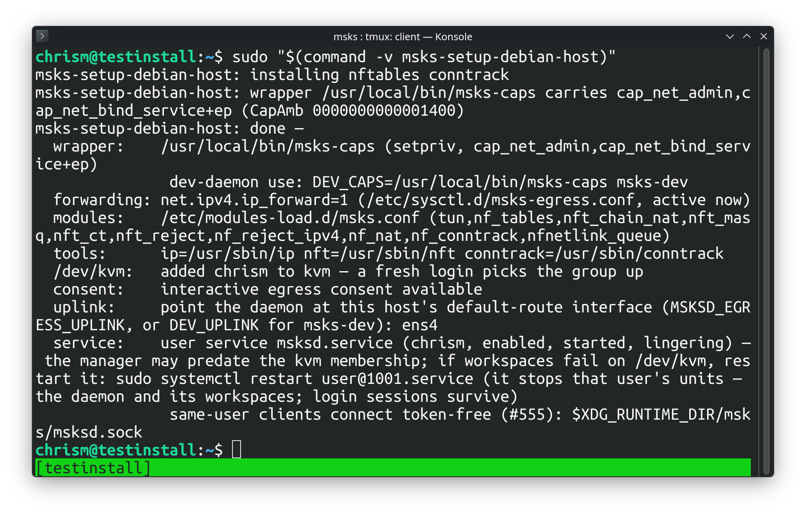

# Installation

msks ships as one Python wheel with everything inside: the client (`msks`), the
daemon (`msksd`), the consent-decider terminal (`msks-term-popup`), and the
Debian host setup this chapter describes (`msks-setup-debian-host`).

The wheel needs Python 3.14 or newer.

```bash
   curl -LsSf https://astral.sh/uv/install.sh | sh
   source $HOME/.local/bin/env
   uv tool install --python 3.14 msks
```

There is an automated setup for the remainder on Debian-derived hosts — Debian
itself, Ubuntu 24.04 or newer, and Linux Mint 22 or newer (the platform gate
accepts the `debian`, `ubuntu`, and `linuxmint` os-release IDs with those
release floors: older Ubuntu and Mint archives lack `virtiofsd`, which the
setup installs). It's
currently bridge-out for any other type of Linux host, save for NixOS, which
remains undocumented now, apologies.

## Setup using `msks-setup-debian-host` console script

The msks daemon runs the workspaces directly on the host using
[cloud-hypervisor](https://github.com/cloud-hypervisor/cloud-hypervisor) and
various networking and kernel-y bits need to be satisfied for it to work
properly.

The host therefore needs pieces the wheel cannot carry. These are software
dependency packages, kernel modules, a routing sysctl, two capabilities for the
daemon's user, and a service that keeps `msksd` running.

On a Debian deployment host, use `msks-setup-debian-host` console script
(installed by the wheel) to do those things:

```console
sudo "$(command -v msks-setup-debian-host)"
```

The quoted form matters: the console script lands in `~/.local/bin`, which
sudo's path does not carry — the bare name would answer "command not
found".

Run it as the user the daemon will serve under `sudo`, the `SUDO_USER` account
is the executing user, and the service the tool registers will belong to your
normal user account.



The run is idempotent: re-run any time, and re-run after a util-linux upgrade
(the wrapper keeps a copy of `setpriv`; see below).

## Taking the setup back off

`msks-setup-debian-host --uninstall` reverses the run: it stops and
disables the `msksd` user service and removes its unit file and its
enablement symlink (the stop lets the daemon finish its shutdown
cycle, workspaces included), turns linger off, removes the two `/etc`
files the run landed, removes the capability wrapper, takes the
executing user out of the `kvm` group (the tool keeps no record of
which run added a membership, so any member leaves — the summary
names the `adduser` line that restores it), strips the PATH block
from `~/.profile`, and removes the cloud-hypervisor binary. Kernel
modules already loaded stay loaded until the next reboot.

After the sysctl file leaves, `sysctl --system` re-applies every remaining
sysctl.d file — the same set a boot applies. A second owner that wrote its
own forwarding file keeps its setting; a live-only forwarder the tool never
saw keeps its value too. On a host where no remaining file names
`net.ipv4.ip_forward`, the live value the setup run set stays on until the
next reboot — the summary names `sysctl -w net.ipv4.ip_forward=0` for
the operator who wants it off immediately.

The apt packages the run installed stay installed — they are shared
Debian packages, and other software on the host may use them. The
uninstall summary prints the ones whose probes answer present, with a
copy-paste `apt-get remove --purge ...` line, so you can remove the ones
nothing else needs yourself.

The uninstall run is idempotent the same way: a piece already gone is a
line in the summary, not an error, and the first real refusal stops the
run — the setup run's rule. `--no-service` holds its meaning — the
service is left alone, every other piece still leaves.

## What the setup lands

Each phase runs in order, and the first refusal stops the run with an error.

**Apt packages**. The apt packages required by the server and the
client.

**The capability wrapper.** `/usr/local/bin/msks-caps` — a
root-owned copy of util-linux `setpriv` carrying file
capabilities `cap_net_admin` and `cap_net_bind_service`. The
daemon's per-VM taps and nftables chains need `net_admin`; the
egress stack's DHCP (port 67) and DNS (port 53) need
`net_bind_service`. The wrapper raises both caps ambient, so
they flow to the daemon and every tool it execs — and the grant
surface is the wrapper's execute permission: any local user
able to run it holds the two capabilities through it. After
installing it the setup runs the wrapper and verifies the caps.

**The routing kernel.** `/etc/sysctl.d/msks-egress.conf` sets
`net.ipv4.ip_forward=1` at boot, and the value applies
immediately: route packets between the per-VM taps and the
host uplink. The daemon reads the sysctl at startup and refuses
every egress workspace, with the cause named, while it reads 0.
`/etc/modules-load.d/msks.conf` loads the netfilter and tun
modules at boot: the nftables machinery, NAT, conntrack, the
deny RST, and the interactive consent queue. A module the
kernel tree lacks lands a warning with the kernel package that
carries it; interactive egress consent needs its whole module
set, and the run's summary names the verdict.

**`/dev/kvm`.** Access arrives through the `kvm` group on the
daemon's user; the setup adds the executing user to the group
when missing. The account picks the group up at the next login; an
already-running session keeps the old groups until it starts
anew.

**The login PATH.** The account that typed the command (the
`SUDO_USER` under sudo) gains `/usr/sbin` and `/sbin` on its
login PATH: the setup appends a guarded block to that account's
`~/.profile`, idempotently, so a re-run never duplicates it.
Debian keeps `nft`, `conntrack`, and the e2fsprogs trio in
`/usr/sbin`, and a non-root login shell does not carry the
directory — the block means the operator's next login can type
the names the daemon execs. A daemon started by the systemd
user unit finds the directories on its own PATH (the unit
manager's default carries them); a daemon started by hand
(`msks-dev`, a bare `msksd`) inherits the session's PATH, so
the same login carries the fix to both shapes.

**The systemd user service.** On a host systemd manages, the
setup writes `~/.config/systemd/user/msksd.service` for the
executing user and enables it. The unit execs `msksd` through
the wrapper, so the file capabilities grant it the same
posture a root unit would have. It runs with
`MSKSD_EGRESS_ENABLED=true` and the uplink interface the setup
detected, and it creates the unix listener's runtime directory
under the user's own `$XDG_RUNTIME_DIR` (`RuntimeDirectory=msks`,
the client's default socket candidate). It restarts the daemon
on failure. Finally, `loginctl enable-linger` keeps the user
manager, and the daemon, running across logouts and boots. A user
manager that was already running may have forked before the kvm
group write reached it; the daemon then holds the old groups
until that manager restarts, and the run's summary says so. A re-run
rewrites the unit and restarts a running daemon onto it when
the unit changed.

**Cloud Hypervisor's static release binary**. So guest VMs can be started.

**PATH manipulation.** Adds `/usr/sbin` to the sudoing user's `PATH` so various
binaries can be found.

The run ends with a summary: the wrapper and its caps, the sysctl, the modules
file and the consent verdict, the tools' paths, `/dev/kvm`, the detected
uplink, and the service line.

You will need to log out and back in for `msksd doctor` to return clean after
using the host installer.

## Setup on a Fedora host

`msks-setup-fedora-host` is the same setup's Fedora entry: one
`HostProfile` — the package map, the probe names, the dnf
verbs, the `usermod`/`gpasswd` group commands — over the same
phases the Debian tool runs (the wrapper, the routing kernel
settings, the packages, the kvm grant, the systemd user
service, the `--uninstall` mirror, the VMM download).

```console
sudo "$(command -v msks-setup-fedora-host)"
```

The run installs through dnf the packages a stock Fedora
answers without: `conntrack-tools`, `qemu-img`, `tmux`,
`virtiofsd`, and the consent stack's `libnetfilter_queue` when
the linker cache lacks the soname. A stock install already
carries the rest of the probed set — `setpriv`, `setcap`, `ip`,
`nft`, `modprobe`, `sysctl`, the e2fsprogs trio, `mkisofs`,
`ssh`, and `rsync` — so those probes read present and the run
moves on. The CA probe names Fedora's own command,
`update-ca-trust` (the ca-certificates package), where the
Debian map probes `update-ca-certificates`.

The kvm membership runs through `usermod -aG kvm`, and the
uninstall summary's removal line is dnf's. A module the
running kernel's tree lacks names the stock kernel package —
`kernel`, or `kernel-16k` on the Asahi host class (a release
string carrying `asahi`).

The same pieces land at the same paths for the same reasons
the Debian section above documents: the wrapper at
`/usr/local/bin/msks-caps` with the two capabilities, the
sysctl and modules files under `/etc`, the user unit under
`~/.config/systemd/user/`, and the cloud-hypervisor static
release for the host's architecture. `--uninstall` reverses
the run the same way.

## The same host by hand (if you'd rather not trust `msks-setup-debian-host`)

`msks-setup-debian-host` is a program the wheel ships, and
running it means running shipped code as root. An operator who
prefers to read every step first can land the same host in an
interactive root shell.

To do so, install the package set — the same set
`msks-setup-debian-host` lands, so a host finished by hand
comes up clean under the doctor too:

```console
sudo -i apt install iproute2 \
                    nftables \
                    conntrack \
                    procps \
                    util-linux \
                    libcap2-bin \
                    kmod \
                    e2fsprogs \
                    qemu-utils \
                    genisoimage \
                    libnetfilter-queue1 \
                    libnfnetlink0 \
                    openssh-client \
                    rsync \
                    tmux \
                    ca-certificates
```

`ca-certificates` is the set's one self-serving package: the CA
bundle the next step's `curl` to github.com needs for its TLS
verification.

The capability wrapper — a fresh root-owned copy of `setpriv`,
with the two capabilities set and read back (a filesystem
without capability xattrs takes the `setcap` and loses it, so
the readback is the proof):

```console
install -o root -g root -m 0755 "$(command -v setpriv)" /usr/local/bin/msks-caps
setcap cap_net_admin,cap_net_bind_service+ep /usr/local/bin/msks-caps
getcap /usr/local/bin/msks-caps
```

The functional proof — the daemon's exact exec line, with the
ambient set inspected in the process it starts (the `CapAmb`
line must carry a nonzero mask):

```console
/usr/local/bin/msks-caps --inh-caps=+net_admin,+net_bind_service \
  --ambient-caps=+net_admin,+net_bind_service \
  -- sh -c "sed -n 's/^CapAmb:[[:space:]]*//p' /proc/self/status"
```

Routing, at boot and now:

```console
printf '%s\n' \
  '# route packets between per-VM taps and the host uplink' \
  'net.ipv4.ip_forward = 1' > /etc/sysctl.d/msks-egress.conf
sysctl -p /etc/sysctl.d/msks-egress.conf
```

The kernel module set, at boot and now:

```console
printf '%s\n' tun nf_tables nft_chain_nat nft_masq nft_ct nft_reject \
  nf_reject_ipv4 nf_nat nf_conntrack nfnetlink_queue \
  > /etc/modules-load.d/msks.conf
modprobe tun nf_tables nft_chain_nat nft_masq nft_ct nft_reject \
  nf_reject_ipv4 nf_nat nf_conntrack nfnetlink_queue
```

Interactive egress consent needs `nft_reject`,
`nf_reject_ipv4`, and `nfnetlink_queue` loaded — check with
`grep -w <module> /proc/modules` (or `lsmod`) when a load
landed quietly.

`/dev/kvm` for the daemon's user, picked up at that account's
next login:

```console
usermod -aG kvm <the-user-the-daemon-runs-as>
```

The systemd user service is the daemon user's own piece — leave
the root shell and run it as that user. Write
`~/.config/systemd/user/msksd.service` with the unit below
(adjust the `msksd` path to where the install put it, and the
uplink to this host's default-route interface — `ip route show
default` names it):

```ini
[Unit]
Description=msks daemon (workspaces as cloud-hypervisor microvms)

[Service]
ExecStart=/usr/local/bin/msks-caps --inh-caps=+net_admin,+net_bind_service --ambient-caps=+net_admin,+net_bind_service -- /path/to/msksd
Environment=MSKSD_EGRESS_ENABLED=true
Environment=MSKSD_EGRESS_UPLINK=<uplink>
RuntimeDirectory=msks
Restart=always
RestartSec=1
TimeoutStopSec=180s

[Install]
WantedBy=default.target
```

Then enable it, as that user:

```console
systemctl --user enable --now msksd.service
loginctl enable-linger <the-user-the-daemon-runs-as>
```

`loginctl enable-linger` is the one root command among these —
it keeps the user manager, and the daemon, running across
logouts and boots.

The daemon's workspace machinery execs `cloud-hypervisor` (the VMM).

Cloud Hypervisor's static release binary is the
sanctioned VMM install — Debian's archive does not carry it.

```console
curl -L -o cloud-hypervisor-static \
  https://github.com/cloud-hypervisor/cloud-hypervisor/releases/latest/download/cloud-hypervisor-static
curl -L -o ch-remote-static \
  https://github.com/cloud-hypervisor/cloud-hypervisor/releases/latest/download/ch-remote-static
sudo install -m755 cloud-hypervisor-static /usr/local/bin/cloud-hypervisor
sudo install -m755 ch-remote-static /usr/local/bin/ch-remote-static
```

## The host doctor

The [The host doctor](doctor.md) chapter documents the `msksd doctor` command
that can diagnose installation issues.

## Apple Silicon hosts

An Apple Silicon host (the Asahi Linux class — Fedora Asahi
Remix on an M-series machine) runs the daemon, builds and
imports guest images, and manages the workspace lifecycle, and
its kernel's KVM does not yet deliver guest interrupts
([#649](https://github.com/mcdonc/msks/issues/649)): a workspace
starts and its kernel boots deep into first boot, then stalls
before ssh answers. Everything short of a guest boot works, so
such a host serves today as a build and authoring machine — the
`msks` client can point `MSKSC_URL` at a daemon on any host
whose KVM is complete, and drives workspaces there. `msksd
doctor` names the condition on these hosts with a warning row;
retest after each kernel update with `msks start` and the
console — the limitation is the kernel's to lift.

## The alternative paths

**A development host** (this repository's checkout) runs the
daemon through Nix and devenv; the [Development
environment](development.md) chapter owns that path.
