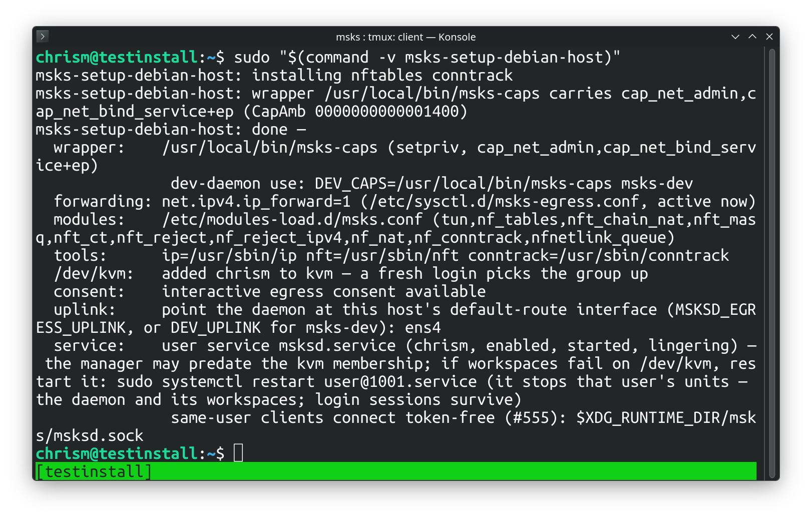

# Installation

msks ships as a Python distribution with everything inside: the client
(`msks`), the daemon (`msksd`), the consent-decider terminal
(`msks-term-popup`), and host setup scripts this chapter describes
(`msks-setup-debian-host`, `msks-setup-fedora-host`, and
`msks-setup-macos-host`).

_msks_ needs Python 3.14 or newer.

Install the Python distribution using `uv`:

```bash
   curl -LsSf https://astral.sh/uv/install.sh | sh
   source $HOME/.local/bin/env
   uv tool install --python 3.14 msks
```

There is an automated setup script for the remainder on Debian-derived,
Fedora-derived hosts, and macOS hosts, each described below. A NixOS host
installs from the flake instead. The [NixOS hosts](#nixos-hosts) section
below describes that install.

## NixOS hosts

A NixOS host gets the whole install from the flake at
`github:mcdonc/msks`. Add the flake as an input, import the module, and
enable the service:

```nix
{
  inputs.msks.url = "github:mcdonc/msks";

  outputs = { self, nixpkgs, msks }: {
    nixosConfigurations.myhost = nixpkgs.lib.nixosSystem {
      system = "x86_64-linux";
      modules = [
        msks.nixosModules.msks
        {
          services.msksd.enable = true;
          services.msksd.egress.uplink = "eno4"; # ip route show default
        }
      ];
    };
  };
}
```

`egress.uplink` is the interface workspace egress masquerades out of.
Set it to the host's default-route interface. `ip route show default`
prints it. The module requires a value while egress is enabled (the
default). A wrong interface installs cleanly and NAT matches nothing.
That failure mode is why the module refuses to guess.

Importing the module alone installs nothing. All of its host
configuration applies only when `services.msksd.enable` is set.

Setting `enable = true` does four things:

- **The binaries on PATH.** The msks console scripts (`msks`, `msksd`,
  `msks-term-popup`, the `msks-setup-*` tools) go on the system PATH for
  every user of the host. They are the same derivation the service unit
  runs.
- **The service.** `msksd.service` starts at boot as the dedicated
  `msksd` system user. The user reaches `/dev/kvm` through the `kvm`
  group.
- **The settings file.** The module generates `msksd.yaml` into the nix
  store at build time, with every tool path pointing into the store. The
  [Configuration](config.md) chapter documents the keys the module
  generates.
- **The egress stack.** With egress enabled the unit carries ambient
  `CAP_NET_ADMIN` and `CAP_NET_BIND_SERVICE`, loads the tun and nftables
  kernel modules, and sets `net.ipv4.ip_forward = 1`. With
  `egress.enable = false` the egress capability and the kernel modules
  stay off, and a workspace boots without a NIC. A port below 1024 keeps
  `CAP_NET_BIND_SERVICE` in both branches.

Secrets stay out of the module's settings. Point
`services.msksd.environmentFile` at a plain file path such as
`/etc/msksd/env`, and put `MSKSD_BOOTSTRAP_TOKEN` in that file to seed
the first API credential. The unit keeps restarting until the file
exists. A store path here would copy the secret into the world-readable
store.

### The package the module runs

The default `services.msksd.package` builds the msks wheel against the
host's own nixpkgs. That nixpkgs must carry `python314` (nixos-26.05
does). The build applies the flake's certifi overlay across that python
set, and the closure compiles on the host the first time. To run the
flake's own build instead, pin the package:

```nix
services.msksd.package = msks.packages.x86_64-linux.msksd;
```

The pinned build comes from the flake's nixpkgs revision. The unit and
the PATH binaries come from one derivation either way.

### Connecting the client

The daemon's API listens on HTTPS at `127.0.0.1:8660` by default. A
client on the same host exports three variables:

```bash
export MSKSC_URL=https://127.0.0.1:8660
export MSKSC_TOKEN=<the bootstrap token from /etc/msksd/env>
export MSKSC_CAFILE=/var/lib/msksd/msks-ca.pem
```

The daemon writes `msks-ca.pem` into its state directory on first serve
(`/var/lib/msksd` under the module). A client on another host needs the
listener reachable: set `services.msksd.listenAddress` off loopback and
`services.msksd.openFirewall = true`. The daemon's TLS certificate
covers exactly the address in `listenAddress`. A remote client verifies
that name, and the hostname it dials must match it. The [client
environment](cli.md#client-environment) table documents every variable,
and the [API](api.md) chapter documents token minting past the bootstrap
credential.

## What the setup lands

Each phase runs in order, and the first refusal stops the run with an error.
On Apple Silicon, everything except the msks client is installed into a Lima
virtual machine.

**Packages**. The packages required by the server and the
client.

**The capability wrapper.** `/usr/local/bin/msks-caps` — a root-owned copy
of util-linux `setpriv` carrying file capabilities `cap_net_admin` and
`cap_net_bind_service`. The daemon's per-VM taps and nftables chains need
`net_admin`; the egress stack's DHCP (port 67) and DNS (port 53) need
`net_bind_service`. The wrapper raises both caps ambient, so they flow to
the daemon and every tool it execs. The grant surface is the wrapper's
execute permission: any local user able to run it holds the two capabilities
through it. After installing it the setup runs the wrapper and verifies the
caps.

**The routing kernel.** `/etc/sysctl.d/msks-egress.conf` sets
`net.ipv4.ip_forward=1` at boot, and the value applies immediately: route
packets between the per-VM taps and the host uplink. The daemon reads the
sysctl at startup and refuses every egress workspace, with the cause named,
while it reads 0. `/etc/modules-load.d/msks.conf` loads the netfilter and
tun modules at boot: the nftables machinery, NAT, conntrack, the deny RST,
and the interactive consent queue. A module the kernel tree lacks draws a
warning naming the kernel package that carries it. Interactive egress
consent needs its whole module set, and the run's summary names the verdict.

**`/dev/kvm`.** Access arrives through the `kvm` group on the daemon's user.
The setup adds the executing user to the group when missing. The account
picks the group up at the next login. An already-running session keeps the
old groups until it starts anew.

**The login PATH.** The account that typed the command (the `SUDO_USER`
under sudo) gains `/usr/sbin` and `/sbin` on its login PATH: the setup
appends a guarded block to that account's `~/.profile`, idempotently, so a
re-run never duplicates it. Debian keeps `nft`, `conntrack`, and the
e2fsprogs trio in `/usr/sbin`, and a non-root login shell does not carry the
directory. The block means the operator's next login can type the names the
daemon execs. A daemon started by the systemd user unit finds the
directories on its own PATH (the unit manager's default carries them). A
daemon started by hand (`msks-dev`, a bare `msksd`) inherits the session's
PATH, so the same login carries the fix to both shapes.

**The systemd user service.** On a host systemd manages, the setup writes
`~/.config/systemd/user/msksd.service` for the executing user and enables
it. The unit execs `msksd` through the wrapper, so the file capabilities
grant it the same posture a root unit would have, so it can spawn VMs. It
runs with `MSKSD_EGRESS_ENABLED=true` and the uplink interface the setup
detected, and it creates the unix listener's runtime directory under the
user's own `$XDG_RUNTIME_DIR` (`RuntimeDirectory=msks`, the client's default
socket candidate). It restarts the daemon on failure. Finally, `loginctl
enable-linger` keeps the user manager, and the daemon, running across
logouts and boots.

**Cloud Hypervisor's static release binary**. So guest VMs can be started.

**The client links.** `/usr/local/bin/msks` and
`/usr/local/bin/msks-term-popup` are symlinks to the console scripts that
shipped beside the setup tool. They land in the directory the wrapper and
the VMM binary already occupy. Every login shell carries `/usr/local/bin`,
so a bare `msks` answers for every user on the host with no profile edits. A
GUI-opened terminal window resolves the consent-terminal launcher on its own
PATH. A regular file or a live link to another target at a path refuses by
name: the run never clobbers what it did not land. A dangling link
re-points, stale by definition. `--uninstall` removes both.

**PATH manipulation.** Adds `/usr/sbin` to the sudoing user's `PATH` so various
binaries can be found.

The run ends with a summary: the wrapper and its caps, the sysctl, the modules
file, the tools' paths, `/dev/kvm`, the login PATH block, the client links, the
consent verdict, the detected uplink, and the service line.

You will need to log out and back in for `msksd doctor` to return clean after
using the host installer.

## Setup on a Debian host

You can use the `msks-setup-debian-host` script to set up `msks` on Debian
13, Ubuntu 24.04 or newer, and Linux Mint 22 or newer.

_The platform gate accepts the `debian`, `ubuntu`, and `linuxmint`
os-release IDs with those release floors: older Ubuntu and Mint archives
lack `virtiofsd`, which the setup requires_. _One version caveat: host
mounts need virtiofsd 1.13.0 or newer, and Linux Mint 22's archive ships
1.10.0. `msksd doctor` gives the gap, and the workaround is a self-built
virtiofsd pointed at with `MSKSD_VIRTIOFSD` (see [mounts](mounts.md))_.

The msks daemon runs the workspaces directly on the host using
[cloud-hypervisor](https://github.com/cloud-hypervisor/cloud-hypervisor) and
various networking and kernel-y bits need to be satisfied for it to work
properly.

The host therefore needs pieces the wheel cannot carry. These are software
dependency packages, kernel modules, a routing sysctl, two capabilities for the
daemon's user, and a service that keeps `msksd` running.

On a Debian deployment host, use `msks-setup-debian-host` console script
(installed by the wheel) to do those things.

You can run it like this after installing the msks Python distribution:

```console
sudo "$(command -v msks-setup-debian-host)"
```

The quoted form matters: the console script lands in `~/.local/bin`, which
sudo's path does not carry — the bare name would answer "command not
found".

Run it as the user the daemon will serve under `sudo`, the `SUDO_USER` account
is the executing user, and the service the tool registers will belong to your
normal user account.



The run is idempotent: re-run any time, and re-run after a util-linux upgrade
(the wrapper keeps a copy of `setpriv`; see below).

## Setup on a Fedora host

`msks-setup-fedora-host` is the way to install msksd on Fedora: it contains
a `HostProfile` (the package map, the probe names, the dnf verbs, the
`usermod`/`gpasswd` group commands) over the same phases the Debian tool
runs (the wrapper, the routing kernel settings, the packages, the kvm grant,
the systemd user service, the `--uninstall` mirror, the VMM download).

```console
sudo "$(command -v msks-setup-fedora-host)"
```

The run installs through dnf the packages a stock Fedora answers without:
`conntrack-tools`, `qemu-img`, `tmux`, `virtiofsd`, and the consent stack's
`libnetfilter_queue` when the linker cache lacks the soname. A stock install
already carries the rest of the probed set (`setpriv`, `setcap`, `ip`,
`nft`, `modprobe`, `sysctl`, the e2fsprogs trio, `mkisofs`, `ssh`, and
`rsync`), so those probes read present and the run moves on. The CA probe
names Fedora's own command, `update-ca-trust` (the ca-certificates package),
where the Debian map probes `update-ca-certificates`.

The kvm membership runs through `usermod -aG kvm`, and the
uninstall summary's removal line is dnf's.

The same pieces land at the same paths for the same reasons
the Debian section above documents: the wrapper at
`/usr/local/bin/msks-caps` with the two capabilities, the
sysctl and modules files under `/etc`, the user unit under
`~/.config/systemd/user/`, and the cloud-hypervisor static
release for the host's architecture. `--uninstall` reverses
the run the same way.

## The same host by hand (if you'd rather not trust `msks-setup-{debian,fedora}-host`)

`msks-setup-{debian,fedora}-host` is a program the wheel ships, and
running it means running shipped code as root. An operator who
prefers to read every step first can land the same host in an
interactive root shell.

To do so, install the package set. It is the same set
`msks-setup-{debian,fedora}-host` lands, so a host finished by hand comes up
clean under the doctor too:

```console
sudo -i apt install iproute2 \
                    nftables \
                    conntrack \
                    procps \
                    util-linux \
                    libcap2-bin \
                    kmod \
                    e2fsprogs \
                    qemu-utils \
                    genisoimage \
                    libnetfilter-queue1 \
                    libnfnetlink0 \
                    openssh-client \
                    rsync \
                    tmux \
                    ca-certificates
```

`ca-certificates` is the set's one self-serving package: the CA
bundle the next step's `curl` to github.com needs for its TLS
verification.

The capability wrapper is a fresh root-owned copy of `setpriv`, with the two
capabilities set and read back. A filesystem without capability xattrs takes
the `setcap` and loses it, so the readback is the proof:

```console
install -o root -g root -m 0755 "$(command -v setpriv)" /usr/local/bin/msks-caps
setcap cap_net_admin,cap_net_bind_service+ep /usr/local/bin/msks-caps
getcap /usr/local/bin/msks-caps
```

The functional proof — the daemon's exact exec line, with the
ambient set inspected in the process it starts (the `CapAmb`
line must carry a nonzero mask):

```console
/usr/local/bin/msks-caps --inh-caps=+net_admin,+net_bind_service \
  --ambient-caps=+net_admin,+net_bind_service \
  -- sh -c "sed -n 's/^CapAmb:[[:space:]]*//p' /proc/self/status"
```

Routing, at boot and now:

```console
printf '%s\n' \
  '# route packets between per-VM taps and the host uplink' \
  'net.ipv4.ip_forward = 1' > /etc/sysctl.d/msks-egress.conf
sysctl -p /etc/sysctl.d/msks-egress.conf
```

The kernel module set, at boot and now:

```console
printf '%s\n' tun nf_tables nft_chain_nat nft_masq nft_ct nft_reject \
  nf_reject_ipv4 nf_nat nf_conntrack nfnetlink_queue \
  > /etc/modules-load.d/msks.conf
modprobe tun nf_tables nft_chain_nat nft_masq nft_ct nft_reject \
  nf_reject_ipv4 nf_nat nf_conntrack nfnetlink_queue
```

Interactive egress consent needs `nft_reject`,
`nf_reject_ipv4`, and `nfnetlink_queue` loaded — check with
`grep -w <module> /proc/modules` (or `lsmod`) when a load
landed quietly.

`/dev/kvm` for the daemon's user, picked up at that account's
next login:

```console
usermod -aG kvm <the-user-the-daemon-runs-as>
```

The systemd user service is the daemon user's own piece — leave the root
shell and run it as that user. Write `~/.config/systemd/user/msksd.service`
with the unit below. Adjust the `msksd` path to where the install put it,
and the uplink's default-route interface (default via 192.168.1.1 dev eno4
proto dhcp src 192.168.1.112 metric 100 gives it):

```ini
[Unit]
Description=msks daemon (workspaces as cloud-hypervisor microvms)

[Service]
ExecStart=/usr/local/bin/msks-caps --inh-caps=+net_admin,+net_bind_service --ambient-caps=+net_admin,+net_bind_service -- /path/to/msksd
Environment=MSKSD_EGRESS_ENABLED=true
Environment=MSKSD_EGRESS_UPLINK=<uplink>
RuntimeDirectory=msks
Restart=always
RestartSec=1
TimeoutStopSec=180s

[Install]
WantedBy=default.target
```

Then enable it, as that user:

```console
systemctl --user enable --now msksd.service
loginctl enable-linger <the-user-the-daemon-runs-as>
```

`loginctl enable-linger` is the one root command among these —
it keeps the user manager, and the daemon, running across
logouts and boots.

The daemon's workspace machinery execs `cloud-hypervisor` (the VMM).

Cloud Hypervisor's static release binary is the
sanctioned VMM install — Debian's archive does not carry it.
The release ships one static build per architecture. The asset
names below are the x86-64 ones. On an aarch64 host, append
`-aarch64` to each asset name (`cloud-hypervisor-static-aarch64`,
`ch-remote-static-aarch64`) in the curl and install lines alike.

```console
curl -L -o cloud-hypervisor-static \
  https://github.com/cloud-hypervisor/cloud-hypervisor/releases/latest/download/cloud-hypervisor-static
curl -L -o ch-remote-static \
  https://github.com/cloud-hypervisor/cloud-hypervisor/releases/latest/download/ch-remote-static
sudo install -m755 cloud-hypervisor-static /usr/local/bin/cloud-hypervisor
sudo install -m755 ch-remote-static /usr/local/bin/ch-remote
```

## macOS on Apple Silicon hosts

Running `msks-setup-macos-host` runs the macOS installer, which is expected to
work on M3+ Macs. It installs the Lima virtual machine system (via Brew), and
runs msksd within a Lima VM. The msks client runs on the Mac itself.

The msksd VM that `msks-setup-macos-host` creates from the shipped Lima
template is the host that shares Mac folders into workspaces. The VM mounts
them under its reserved prefix and forwards each attached share to the
workspace that asked for it; see the [mounts chapter's macOS
section](mounts.md#shares-on-a-macos-host).

### Sizing the msksd Lima VM

The VM starts at the template's sizing — 4 CPUs, 8 GiB of memory, a
60 GiB disk — and the sizing flags change it at creation and on every
re-run:

```sh
msks-setup-macos-host --cpus 8 --memory 16 --disk 200
```

A changed value stops the VM, edits its instance, and starts it again:
running workspaces stop with the VM, and each starts again with
`msks start`. Equal values change nothing, so the command is
safe to re-run in scripts. The disk only grows: a smaller value refuses,
naming both sizes — reclaim space with `msks storage` instead. The disk
is sparse, so it fills on demand up to the size you set. The floors are
2 CPUs, 4 GiB of memory, and 20 GiB of disk: the VM must hold the daemon
and a workspace.

When the VM's disk runs low, the daemon's storage warning and the 507
refusal name the same grow command. The fix is one re-run away.

## Linux on Mac Hardware

It doesn't work on Asahi. An Apple Silicon host whose kernel runs KVM in NV
mode does not yet deliver guest interrupts
([#649](https://github.com/mcdonc/msks/issues/649)): a workspace starts and its
kernel boots deep into first boot, then stalls before ssh answers.

## Uninstalling msks

`msks-setup-{debian,fedora,macos}-host --uninstall` reverses the run. It
stops and disables the `msksd` user service and removes its unit file and
its enablement symlink; the stop lets the daemon finish its shutdown cycle,
workspaces included. It turns linger off, removes the two `/etc` files the
run landed, and removes the capability wrapper. It takes the executing user
out of the `kvm` group; the tool keeps no record of which run added a
membership, so any member leaves, and the summary names the `adduser` line
that restores it. It strips the PATH block from `~/.profile` and removes the
cloud-hypervisor binary. Kernel modules already loaded stay loaded until the
next reboot.

After the sysctl file leaves, `sysctl --system` re-applies every remaining
sysctl.d file, the same set a boot applies. A second owner that wrote its own
forwarding file keeps its setting. A live-only forwarder the tool never saw
keeps its value too. On a
host where no remaining file names `net.ipv4.ip_forward`, the live value the
setup run set stays on until the next reboot. The summary names `sysctl -w
net.ipv4.ip_forward=0` for the operator who wants it off immediately.

The packages the run installed stay installed: they are shared packages, and
other software on the host may use them. The uninstall summary prints the
ones whose probes answer present, with a copy-paste `apt-get remove --purge
...` line. You can remove the ones nothing else needs yourself.

The uninstall run is idempotent the same way: a piece already gone is a line
in the summary, not an error, and the first real refusal stops the run: the
setup run's rule. `--no-service` holds its meaning: the service is left
alone, every other piece still leaves.

## The host doctor

The [The host doctor](doctor.md) chapter documents the `msksd doctor` command
that can diagnose installation issues.

## The alternative paths

**A development host** (this repository's checkout) runs the daemon through
Nix and devenv. The [Development environment](development.md) chapter owns
that path. A Mac developing from a checkout has its own chapter —
[Developing on a macOS host](development.md#developing-on-a-macos-host).
