# The TUI

The terminal UI and the command-line client are one program. The TUI uses
the same REST API as the CLI commands, with the same environment
variables, config file, and daemon aliases. It reads no daemon state
directly: every page uses the API.

A bare `msks` (no arguments at all) launches the full-screen workspace
tree. `msks tui` is the same command, and `msks tui my-workspace` opens
that workspace's page directly.

## The workspace tree

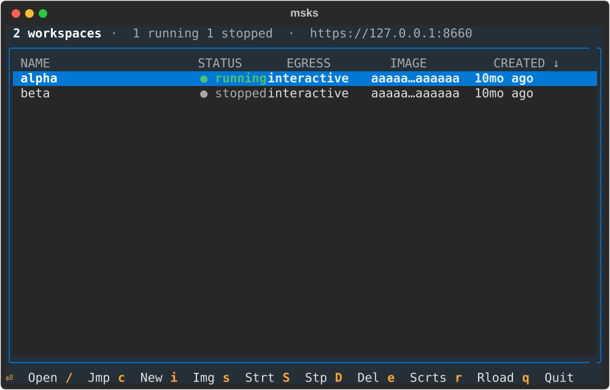

The tree is rooted at the **workspaces list**: one row per workspace,
newest first. The CREATED column's arrow shows the sort direction. The
list's keys: `c` creates a workspace, `s` starts it, `S` stops it, `D`
removes it (after a confirmation), `e` opens the secrets page, and `r`
refreshes. `/` jumps to the first workspace whose name starts with what
you type. Enter opens the workspace's page.

The list re-reads the daemon every five seconds. A workspace changed
from another surface (the CLI, another operator) appears without a
keypress.

A workspace with unresolved mounts shows a marker in the status column:
`✗1 stopped` is how many of the workspace's mounts are unresolved. The
marker clears when the config and the workspace agree again. The [mounts
chapter](mounts.md#the-skip-behavior) lists every kind of skip and its
reason. The workspace's page shows each unresolved mount and its kind.

When you create a workspace, it looks like this:

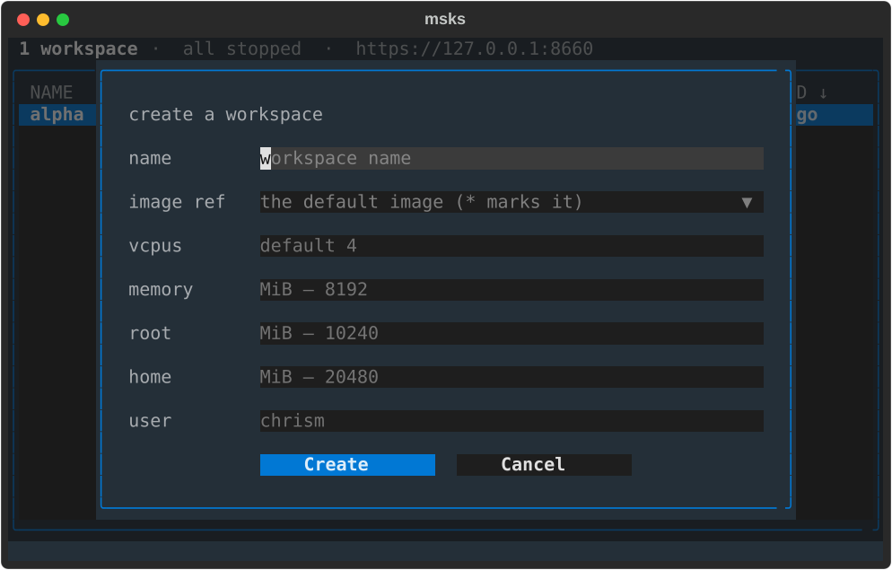

The **secrets page** lists every placeholder the daemon holds, in five
columns: coverage (`*` for the daemon-wide row, otherwise its workspace
ids), name, destinations, remaining lifetime, and created date.

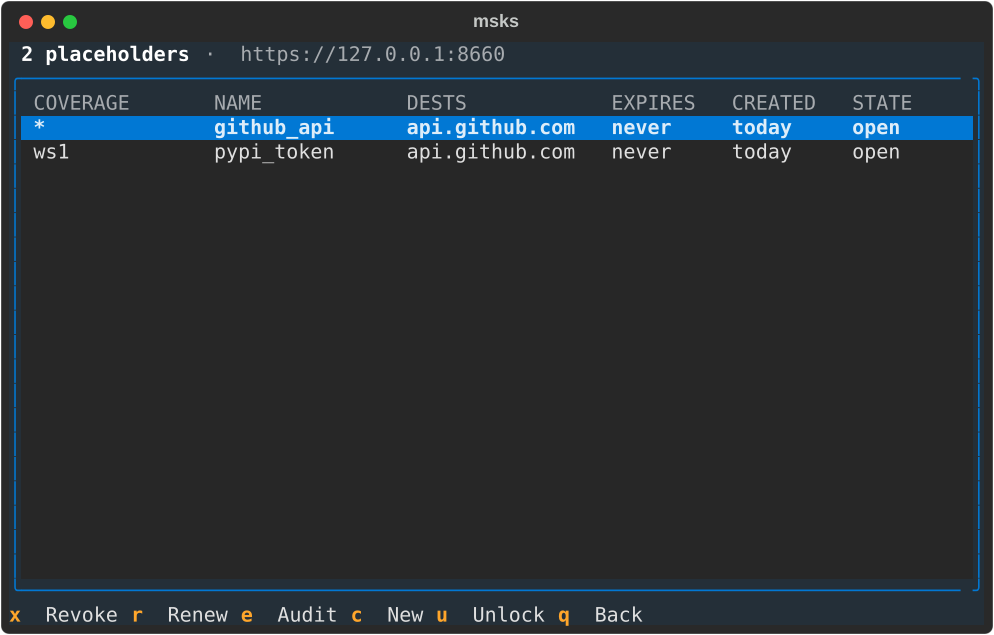

You can register secret placeholders for your workspace to use instead of
putting actual secrets into VMs.

The lifetime cell is a live countdown (`2h`, then `1h`), repainted every
second; an unbounded row reads `never`. `x` revokes the focused row
after a confirmation that explains what a revoke does: the row retires
everywhere at once. `r` opens the duration picker with TTL-appropriate
choices, an hour to thirty days; the choice nearest the row's remaining
lifetime is highlighted. Picking one extends the row in place.

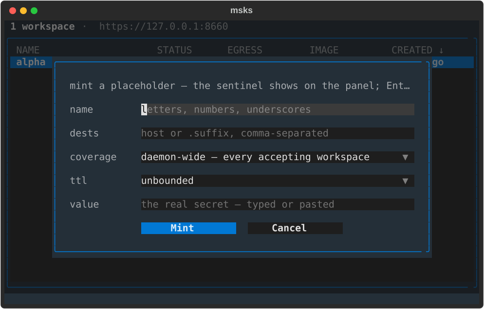

`c` opens the mint form. The name field comes first, then repeatable
destinations: an exact host or a label-anchored suffix, comma-separated
in one field. Coverage follows: the daemon-wide row, or a multi-select
fed by the tree's workspace list. The lifetime field offers `unbounded`
by default, with an hour to thirty days beside it. The value is a masked
field you type or paste into, so the form takes the secret's bytes
directly. Submit checks the secret store first (`msks secret check`'s
endpoint), then mints.

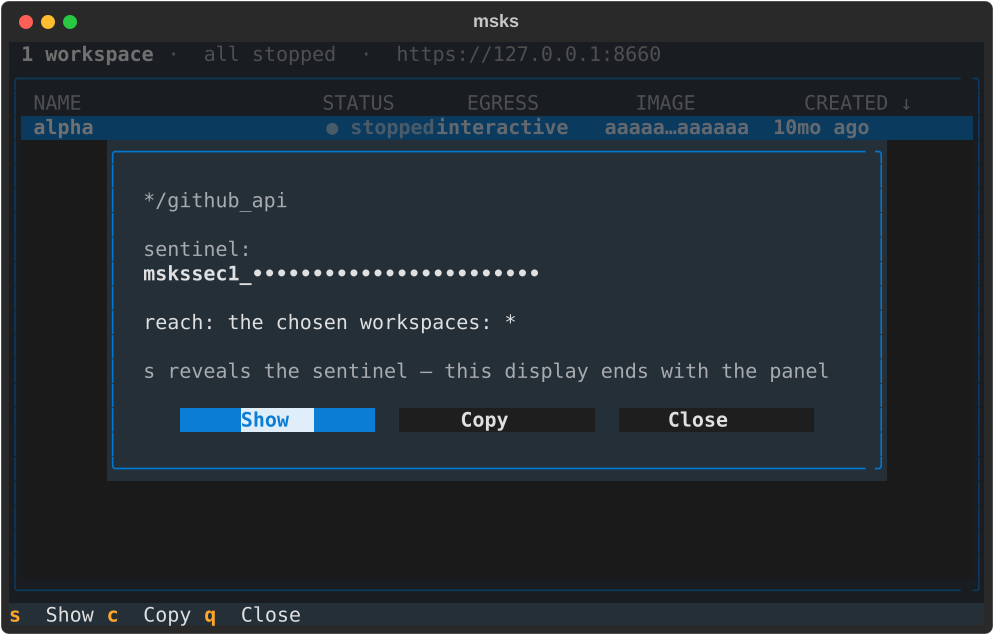

A successful mint replaces the form with the sentinel's panel. The
sentinel opens masked: the prefix shows its reach (`mskssec1_` is
scoped to the chosen workspaces, `mskssec2_` goes to every accepting
workspace), and the body renders as bullets. `s` shows and hides it
again. `c` copies the sentinel to the terminal's clipboard over
OSC 52; a terminal that honors the sequence answers the copy (over ssh
included, with no reveal needed). The display ends with the panel:
closing it clears its text, and the minted row stays in the page's
list. Enter (or a click) on a listing row opens the panel again. The
page fetches the row's sentinel from the daemon and shows it with the
same show and copy actions, so the sentinel reads back on demand, both
at mint time and after. Each placeholder row cross-references its
workspaces, for navigation.

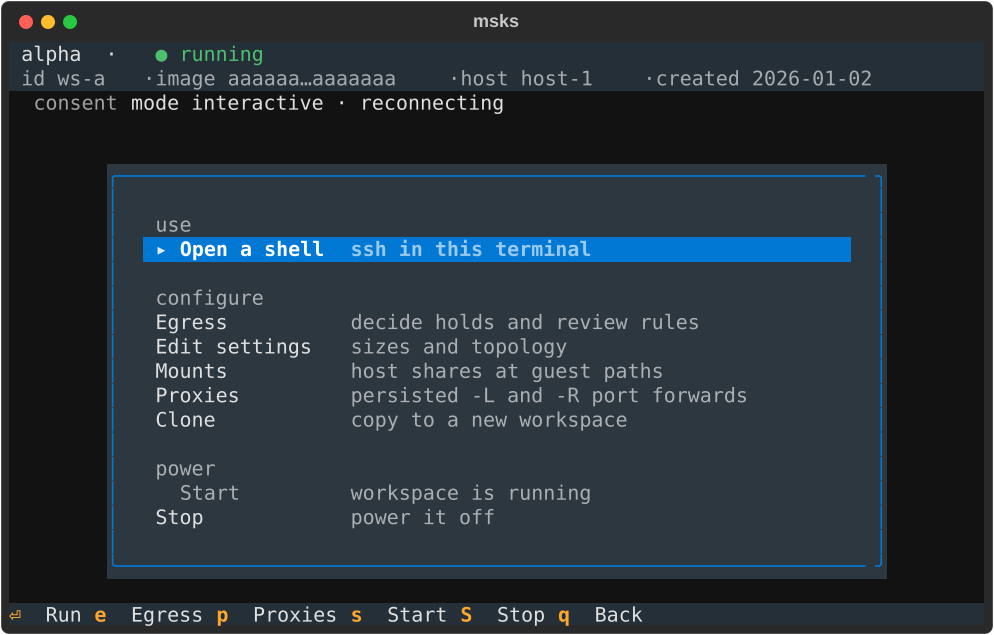

The **workspace page** operates on an already-created workspace. Its
two-line header: the workspace's name on the first line with its status
beside it, in the state's color, then the id, image hash, host, and
created date.

Below it, a status line for egress consent shows the mode and one
granted scope with its expiry. Two or more grants show as a count with
the nearest expiry (`5 grants · next expires 4h`). Grant details are
listed on the workspace's egress consent screen.

When the workspace mounts host shares, a mounts line follows: one entry
per mount (`projects:/mnt/projects:rw`), with derived state beside any
mount the daemon holds unresolved (`refs:/srv/refs:ro (skipped)`), and
a note when a change applies at the next start. The line repaints with
the page's per-second read, so a change made anywhere reaches the page.

The page's actions come in three groups: a shell; egress consent, an
edit dialog for the sizes and topology, and the mounts editor; and
start and stop.

The **mounts editor** shows the workspace's mounts one row each, in the
CLI's `HOST_PATH:GUEST_PATH:MODE` grammar with the mode always shown.
`a` adds a row (a single-line input), Enter edits the focused row
(seeded with its current spec), `r` removes it, and Escape closes the
editor with the last saved set.

Every change posts the whole list to the daemon's mounts route. The
reply repaints each row with its derived state (`healthy`, or the
skip's kind and reason); a refusal appears on the editor's note line,
and the refused list is rolled back. The daemon owns the rules: a host
path outside the allowed roots, or one under a root the daemon's VM
does not mount, is refused with the remedy stated. The [mounts
chapter](mounts.md) and the [configuration
rows](config.md#host-share-mounts) describe the behavior; the CLI's
[`msks mount`](cli.md#msks-mount) uses the same route.

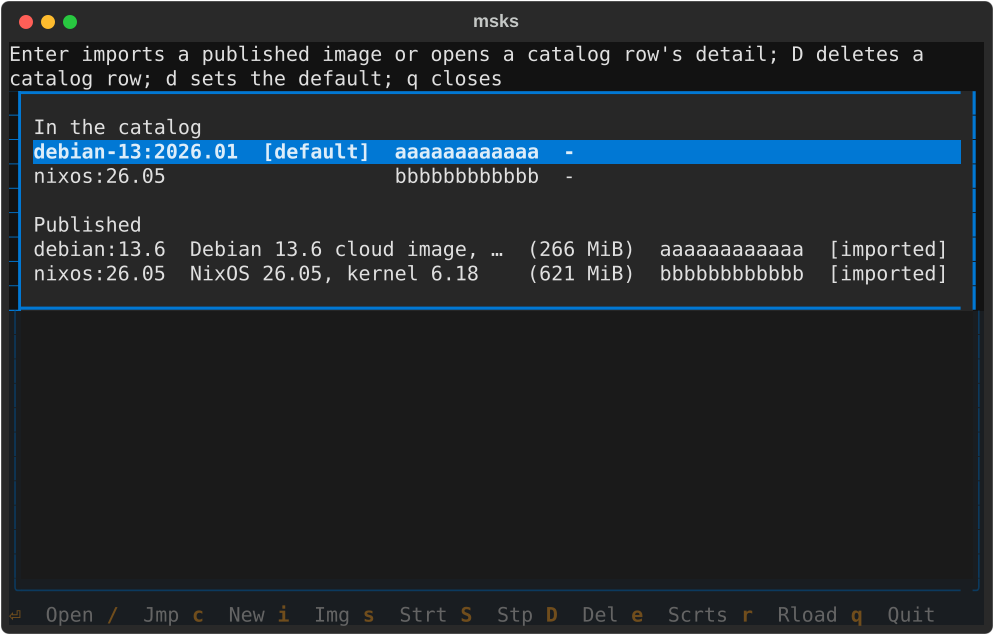

`i`: the image page. The catalog group comes first, with the default
marker and each import's date on its rows. Then the published channel's
rows follow, with their descriptions, sizes, and membership markers.
The published group lists only the rows this daemon's machine can boot:
a row that declares another architecture stays off the page, and a row
that declares none is shown (`msks image import` follows the same
rule). `[imported]` marks a row whose archive the catalog holds by
exact hash match; `[in catalog, other build]` marks a row the catalog
holds under a different hash. 

Enter imports a published row through the daemon's URL import or opens
a catalog row's detail.

`D` deletes a catalog row after a confirmation, the same DELETE `msks
image rm` makes. The page re-reads the workspace each second, so the
dimming follows a start or stop made anywhere, not only on the page. A
workspace the listing no longer sees (removed from another surface)
closes its page, and the removal appears on the list's status line.

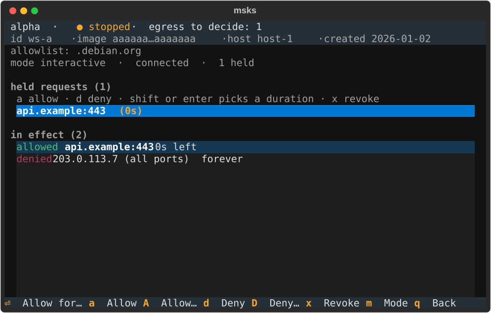

The page's **Egress** action and its `e` key open the egress consent
page: a full-screen view that holds the held-request queue and the
in-effect verdicts together. It is the consent decider as a page inside
the tree, and the only place verdicts are made.

The page carries the same two-line header as the workspace page beneath
it: the workspace's name with its status (and the pending-hold count
while any hold waits), then the id, image hash, host, and created date,
muted. The workspace's identity stays visible while verdicts are made.

Keys on the page: the arrows navigate the held requests and cross into
the verdict rows beneath (and back). `a`/`d` allow or deny the focused
hold for the default duration (`tilrestart`); `A`/`D` pick a duration
first (`once / 5m / 15m / tilrestart / forever`). The letters act on
the holds alone: a press aimed at the wrong zone reports which zone it
would act on, instead of deciding silently. `x` revokes the focused
verdict; the row leaves on the daemon's refreshed frame, never
optimistically.

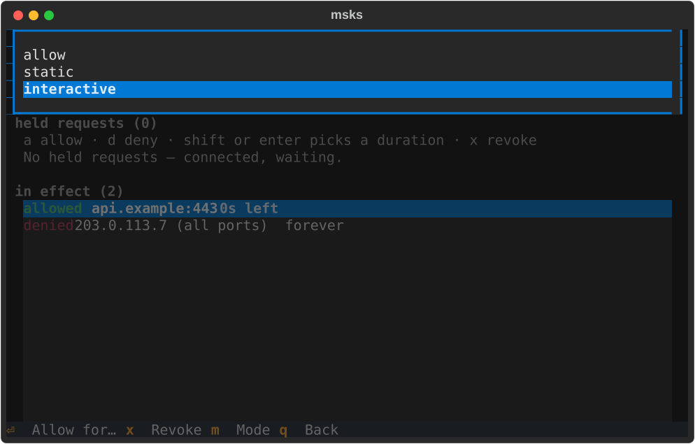

`m` opens the mode picker (`allow` / `static` / `interactive`, the
current mode highlighted). It is the only way to switch modes since the
workspace page's own mode action was removed. Picking a mode switches it
through the same endpoint `msks egress mode` uses, without leaving the
page. The status line shows the new mode once the switch takes effect.
Picking `static` while nothing is effectively allowed asks the same
offline-workspace confirmation the CLI asks: confirm to switch, decline
to change nothing. A refused switch states its reason on the status
line.

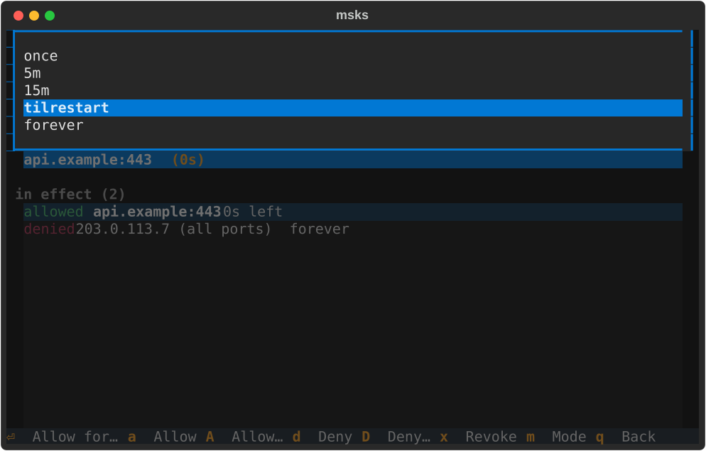

Enter on a focused hold opens the duration picker: the key answers, the
pick decides, and only an explicit letter or a picked duration ever
decides. While no hold waits, the verdict keys do nothing and leave the
footer until one arrives. See [`msks egress`](cli.md#msks-egress) for
what verdicts and rules cover.

The page's **Edit settings** action opens the edit dialog: the create
form's layout, seeded with the workspace's current values. 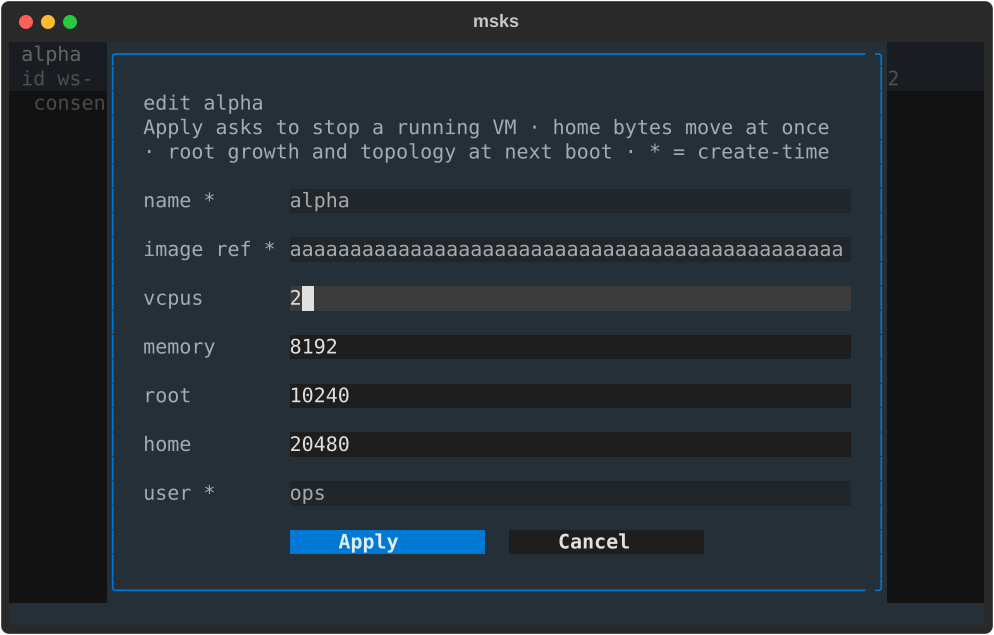

The sizes and topology (root, home, vcpus, memory) are editable. Submit
sends the changed values to the same endpoint `msks resize` uses, and
the page's consent line shows the same outcome the CLI prints,
including changes that wait for the next boot.

A workspace that is running when you press Apply asks first: confirm
and the page stops the workspace, then applies the resize; decline and
the workspace keeps running with its sizes unchanged. Home size changes
apply immediately; root growth and the new topology apply at the next
boot. A resize the daemon still refuses (a root shrink, among others)
states its reason on the consent line. The name, image, and user fields
show their current values read-only, marked `*` as create-time:
changing them is a delete-and-recreate, and the dialog refuses a
changed value with a note pointing at the field, instead of accepting
it silently. A size left blank keeps its current value. Escape closes
the dialog and changes nothing.

The page's **Open a shell** action runs `msks ssh` in the TUI's own
terminal: the tree exits, the ssh session runs where it stood, and the
tree restarts when the session returns the terminal. It uses ssh rather
than the console because the console keeps the getty's geometry while
ssh carries every resize to the guest. A workspace ssh cannot reach (no
NIC, no identity configured) takes a longer path. The flow boots a
stopped workspace first (the ssh session it runs boots it itself) and
probes the forward. A probe that reports a refusal (no NIC, the service
not listening) runs no session: the tree's first flash carries the
refusal's first line and suggests `msks console`, and the full refusal
text is logged before the tree restarts. The console stays a command
you choose to run, not a session the flow opens for you.

An ssh session that ran reports only its exit code, 255 included: ssh
passes a session's own exit through unchanged, and a console after a
finished session would be a surprise, not a fallback. The action works
on a stopped workspace too: the ssh session boots the workspace itself
(it carries the workspace's id, and prints the pre-flight's `msks: <id>
is stopped; starting it`).

A host that wants shells in windows beside the running tree configures
a terminal launcher (`terminal_open_cmd` below). The action then spawns
the launcher with a `msks ssh` invocation appended. The spawned shell
inherits the tree's resolved connection, so it reaches the same daemon.
A launcher that cannot start (a missing binary, one without the execute
bit) reports the reason on the tree's first flash, and the shell runs
in this terminal instead: a chained `msks console` session.

Every screen is navigable with arrow keys. Lists move with up/down, the
create form's fields move with up/down between them, and Escape leaves
the screen it is on. `q` backs out of a page; at the workspaces list,
Escape quits the tree. Ctrl+Q exits the client from any screen (the
tree, a page, a form field, or a panel stacked over them), the same
clean exit `q` takes at the workspaces list.

## The shell action's terminal settings

The workspace page's **Open a shell** action runs `msks ssh`: in the
TUI's own terminal by default, or in a new window through a configured
launcher. Two client settings shape those windows. Their
environment-variable rows are in [the client environment
table](cli.md#client-environment); their file keys are documented here.

## `terminal_open_cmd`

`terminal_open_cmd` is the launcher the workspace page's **Open a
shell** action uses to open workspace shells in new terminal windows; it
is the opt-in for hosts that want windows beside the running tree. The
msks invocation is appended after it, the way most terminals take a
command after `-e` / `--`:

```yaml
terminal_open_cmd: konsole -e          # string form (shell-split)
terminal_open_cmd:                     # Linux (list form, no shell quoting)
  - ghostty
  - +wait
  - -e
terminal_open_cmd:                     # macOS (open launches Ghostty.app)
  - open
  - -na
  - Ghostty.app
  - --args
  - -e
```

On Linux, Ghostty's `-e` takes the appended invocation as the
window's command, and `+wait` holds the ghostty process until the
window closes — the same hold `konsole -e` gives. On macOS the
`ghostty` CLI is a helper tool; `open -n` starts a new Ghostty.app
instance and `--args` hands it the `-e`. A window opened through
`open` runs with a fresh login environment — nothing from the shell
the TUI runs in passes through — so the appended client locates its
packages and its daemon on its own: a venv-installed client is
self-locating, and the config file names the daemon.

`terminal_open_cmd`'s environment form (`MSKSC_TERMINAL_OPEN_CMD`)
overrides the file value with the string form. Unset (the default), the
shell action runs `msks ssh` in the TUI's own terminal, on every host,
with no terminal to launch. A configured launcher that fails to execute
(a binary that is missing or not executable) reports the reason on the
tree's first flash after the same-terminal shell ends, and the shell
runs in the same terminal.

## `terminal_title`

`terminal_title` sets the title of every terminal window the workspace
page's shell action opens through a configured launcher. `{workspace}`
resolves to the workspace's id (the token `msks ssh` addresses; that is
what the TUI appends to the launcher), or to `shell` when the appended
command addresses no workspace:

```yaml
terminal_title: msks — {workspace}
```

Two paths write it. A launcher that runs `msks-term-popup` writes the
title before it attaches tmux, and the launch's own tmux server pins
`set-titles` off, so the title stays for the window's lifetime: a
workspace shell inside the window cannot rewrite it. Every other
launcher gets the title from the appended `msks ssh` itself: the window
msks opens is marked at spawn, and the command sets it before the
session starts. A workspace that sets its own title from inside the
session (a `PROMPT_COMMAND` with a title escape, the way stock ssh
sessions can) rewrites it there. tmux shields the popup path; nothing
shields the plain path.

`terminal_title`'s environment form (`MSKSC_TERMINAL_TITLE`) overrides
the file value. The default is unset: the terminal emulator's own title
stays in place (the command it runs, or whatever its `-T` / `--title`
flag sets). A `msks ssh` you type yourself keeps your terminal's title:
the setting applies only to the windows msks opens, and a same-terminal
shell (the dead-launcher fallback) changes nothing.

## `msks-term-popup`: the consent-decider terminal

`msks-term-popup` is a shipped client command that runs the appended
shell inside a local tmux session and answers the workspace's egress
consent prompts right there. The launch also starts the consent-decider
app in a hidden tmux session on the same socket, where it holds the
workspace's decider registration for the window's whole life. 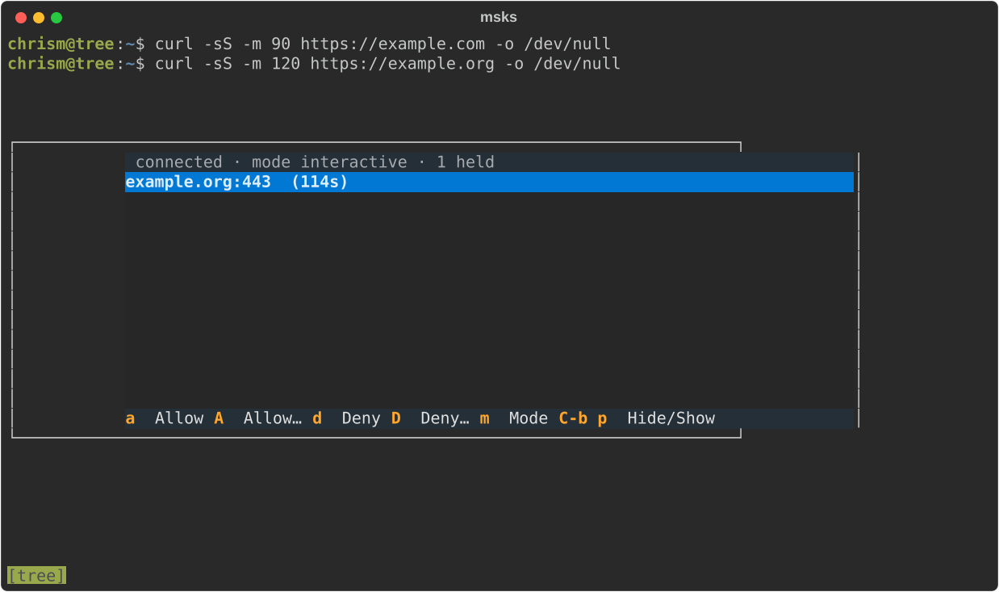

The app lists every hold the workspace carries, destination and time
remaining per row, with the arrow keys moving the selection. `a` allows
until restart and `d` denies the selected hold; the uppercase twins `A`
and `D` pick a duration for their verdict (Enter picks, Escape
cancels). `m` switches the workspace's egress mode. The picker offers
`allow`, `static`, and `interactive` with the current mode highlighted
(Enter picks, Escape or `q` cancels). Picking `static` while nothing is
effectively allowed asks the empty-static question first, the same
confirmation the consent page asks. The switch goes through the same
endpoint `msks egress mode` uses. The status line shows the current
mode beside the connection state, and a completed switch flashes its
effect there (`in effect now`, or `takes effect at next start` for a
stopped workspace). A switch the daemon refuses states its reason on
the same line. A hold leaves the list the moment the daemon resolves it
(a verdict from another decider window, or the hold's own timeout), and
the popup viewer hides itself when the list empties.

A hold arriving with the popup closed raises a popup viewer over the
shell that attaches to the hidden session, and the bindings map runs
along the popup's bottom edge: the verdict keys, the mode switch, and
the hide/show entry. `q`, `Esc`, or `C-b` hide the viewer. The decider
keeps running, its queue keeps living, and `C-b p` brings the popup
back; a popup the app raised returns the same way on the next hold. The
session ends with its window, and the decider registration ends with
the server. It works with any terminal that runs a command: put your
terminal and its command flag in `terminal_open_cmd`, and
`msks-term-popup` right after it (tmux 3.2 or newer must be on PATH):

```yaml
terminal_open_cmd: konsole -e msks-term-popup
terminal_open_cmd: xterm -e msks-term-popup
terminal_open_cmd: ghostty +wait -e msks-term-popup       # Linux
terminal_open_cmd: open -na Ghostty.app --args -e msks-term-popup  # macOS
```

The macOS form needs the brew-prefix links. An `open`-opened
window resolves commands on a fresh login PATH, and
`msks-setup-macos-host` links both client commands there
(#734). tmux comes from that PATH the same way.

The popup viewer keeps its own attach to the hidden session, so a hold
that arrives while it is open is already in the list. Verdicts posted
from it go through the same REST contract as the consent page. A post
that cannot complete (the request resolved in another decider window
while the verdict was in flight) reports the reason on the popup's
status line.

The window the prefix opens takes its title from `terminal_title`
(`msks — {workspace}` resolves the workspace's id into it). The
session's status bar shows the workspace too: the launch resolves the
workspace's name and pins it to the bar's left side (`[project-x]`).
The id stands in whenever the lookup fails (the daemon down, the
workspace gone, the wait run out), and `shell` stands for a plain
shell. The window list after the label stays empty, and so does the
bar's right side, which tmux's default fills with the pane's title, the
clock, and the date: the label is the whole bar.

The hidden consent session runs on the launch's own socket, one small
server per window. The app retires when the window has been gone for a
while, taking the session and the server with it. The window's own hold
flags (`konsole --hold`, xterm's `-hold`) keep the window open after
the session ends, as they do for a plain shell window.

The pane keeps 10000 lines of scrollback and takes the mouse wheel:
wheel up scrolls into the pane's history, wheel down scrolls back
toward the live output, and reaching the bottom (or pressing `q`)
returns to the plain shell. The keyboard path covers the same history:
`Ctrl-b [` (or `Ctrl-b PageUp`) opens tmux's copy mode, where the arrow
keys and PageUp/PageDown move through it. `Shift-PageUp` and
`Shift-PageDown` page through it too, one page per press, entering copy
mode on the way up and returning to the shell at the bottom.

A terminal that keeps the shifted pair for its own view still has the
wheel, because its scrollback has nothing to show on this pane. Konsole
can hand the pair to the pane with a keytab rule scoped to the
alternate screen, sending `\E[5;2~` and `\E[6;2~`. The bare
PageUp/PageDown reach the shell untouched.

These settings, the status bar's name among them, live on the window's
own tmux server (the launch's dedicated socket); an operator's own
running tmux server keeps its own settings. With tmux's mouse mode on,
a plain drag selects text in tmux's buffer, and holding Shift while
dragging selects the terminal's native text (most terminals hand Shift
drags to their own selection). A consent popup raised while the pane is
scrolled still takes its verdict keys: the popup overlays the scrolled
pane, and the next keypress answers it.
