# The TUI

The terminal UI and the command-line client are one program. The TUI uses the
same REST surface the CLI commands speak (the same environment variables, the
same config file, the same daemon aliases) and reads no daemon state directly:
every page uses the API.

A bare `msks` — no arguments at all — launches the full-screen
workspace tree. `msks tui` names the same command, and `msks tui
my-workspace` opens that workspace's page directly.

## The workspace tree

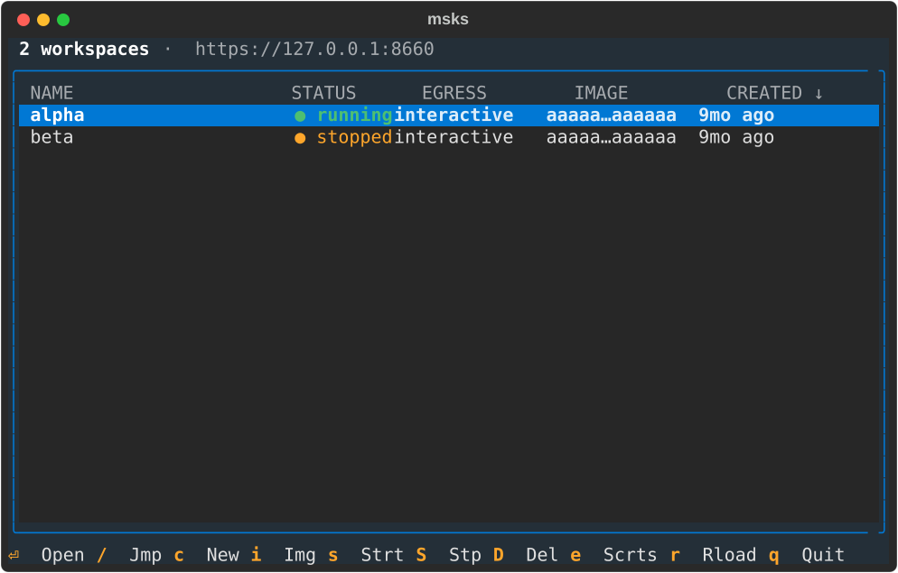

The tree is rooted at the **workspaces list**: every workspace one row, newest
first, with the CREATED column's arrow naming the sort. Creating, starting,
stopping, and removing sit on its keys: `c` new, `s` start, `S` stop, `D`
remove (asked and confirmed), `e` secrets, and `r` refresh. `/` is a typeahead
that jumps the focus to the first row whose name starts with what you
type. Enter opens the workspace's page.

The list re-reads the daemon every five seconds, so a workspace another surface
moved (the CLI, another operator) appears without a keypress.

A workspace whose mounts skip or conflict carries a marker in the
status column — `✗1 stopped` — the count of mounts the daemon's
derived state holds unresolved (a share the config no longer
carries, an `rw` mount a reload narrowed its share under, or a
read-write attach held elsewhere). The workspace's page names each
one; the [mounts chapter](mounts.md#the-skip-behavior) states the
behavior.

When you create a workspace, it looks like this:

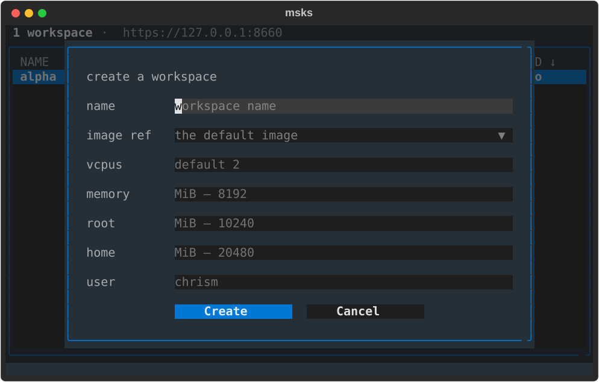

The **secrets page** lists every placeholder row the daemon
holds, in the listing's own five-column shape: coverage (`*` for
the daemon-wide row, the workspace ids scoped), name,
destinations, the remaining lifetime, the created date.

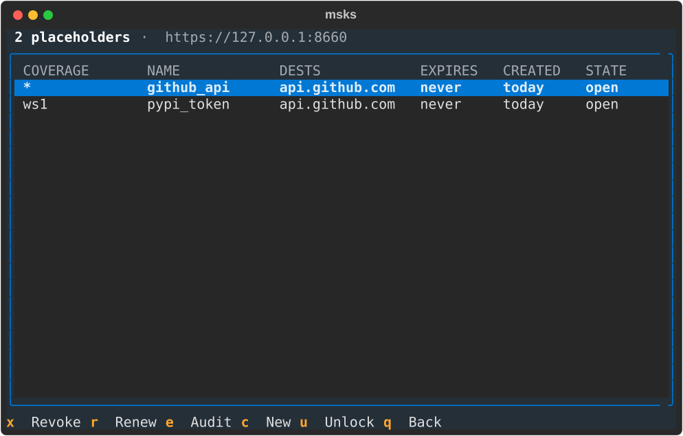

You can register secret placeholders for your workspace to use instead of
putting actual secrets into VMs.

The lifetime cell is a live countdown — `2h`, then `1h`, repainted every second
— and reads `never` on an unbounded row. `x` revokes the focused row after a
confirmation that names what a revoke does (the row retires everywhere at
once). `r` opens the duration picker over TTL-appropriate choices, an hour to
thirty days with the choice nearest the row's remaining lifetime highlighted,
and extends the row in place.

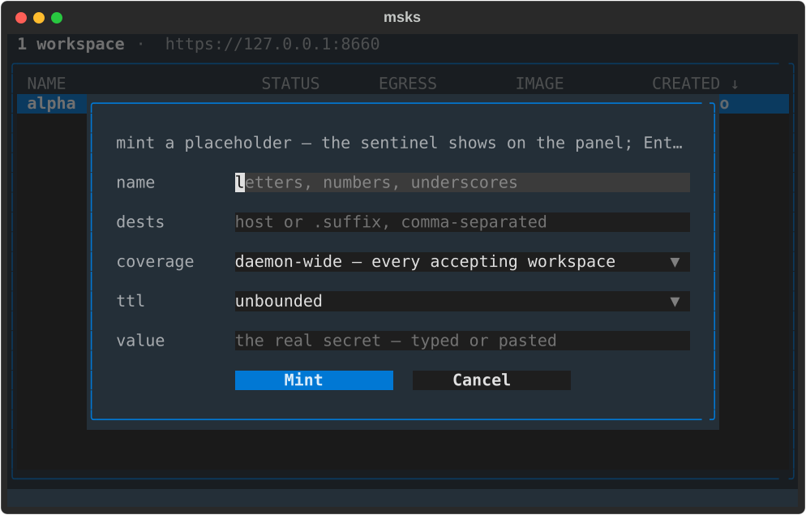

`c` opens the mint form. The name field comes first, then
repeatable destinations (an exact host or a label-anchored
suffix, comma-separated in one field). Coverage follows: the
daemon-wide row, or a multi-select fed by the tree's own
workspace list. The lifetime field offers `unbounded` by
default with an hour to thirty days beside it. The value is a
masked field the operator types or pastes into, so the form
takes the secret's bytes directly. The submit checks the secret store first (`msks secret
check`'s endpoint), then mints.

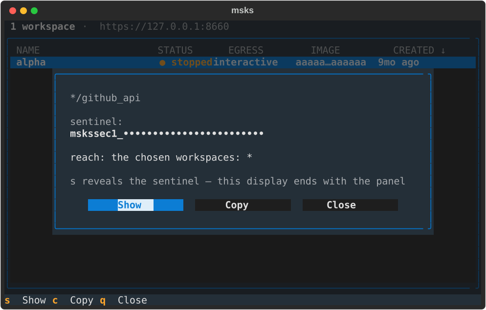

A mint that lands replaces the form with the sentinel's
panel. The sentinel opens masked, its prefix naming the reach
(`mskssec1_` scoped to the chosen workspaces, `mskssec2_`
every accepting workspace) and its body rendering as bullets.
An `s` Show action reveals and hides it again. A `c` copy
action writes the sentinel to the terminal's clipboard over
OSC 52, the copy path a terminal that honors the sequence
answers (over ssh included, with no reveal needed). The
closing rule: the display ends with the panel. Enter (or a click) on a listing row opens the panel again.
The page fetches the row's sentinel from the daemon and shows
it with the same show and copy actions, so the sentinel reads
back on demand, at mint and after.
Closing the panel clears its text, and the minted row
stands on the page's list. The placeholder-to-workspace
navigation lands with the cross-references.

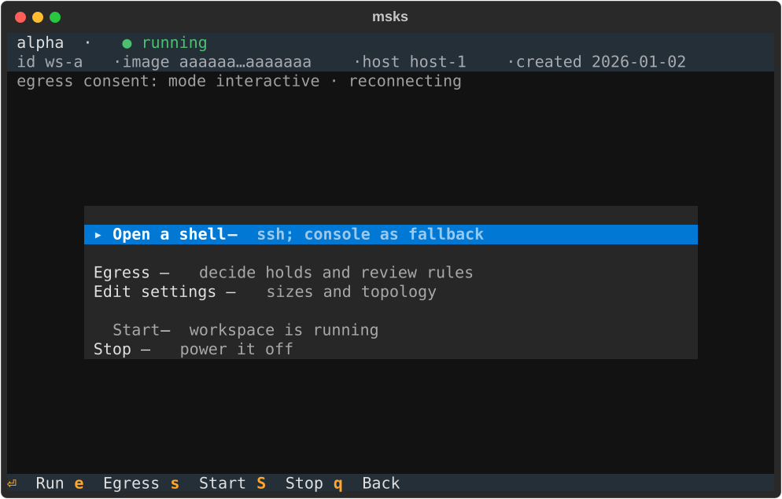

The **workspace page** allows users to operate against an already-created
workspace. Its two-line header sets the workspace's name on the first line with
its status beside it in the state's color, and the id, image hash, host, and
created date.

A status line for egress consent follows: the mode, then one granted scope
named with its expiry. Two or more grants read as a count with the nearest
expiry (`5 grants · next expires 4h`); grant detail is listed on the
workspace's egress consent screen.

A mounts line follows when the workspace mounts host shares: one
entry per mount — `projects:/mnt/projects:rw` — with the derived
state beside any the daemon holds unresolved
(`refs:/mnt/refs:ro (skipped)`), and the next-start note naming
the semantics. The line repaints with the page's per-second read,
so a change made anywhere follows onto the page.

The page's actions center in three groups. A shell; egress
consent, an edit dialog for the sizes and topology, and the
mounts editor; and start and stop.

The **mounts editor** holds the workspace's mounts one row each —
the CLI's own `SHARE:GUEST_PATH:MODE` grammar, the mode always
shown. `a` adds a row (a single-line input), Enter edits the
focused row seeded with its spec, `r` removes it, and Escape
closes the editor with the last saved set. Every change posts the
whole list through the daemon's mounts route — the reply repaints
each row with its derived state (`healthy`, or the skip's kind
and reason), and a refusal names itself on the editor's note line
with the list it refused rolled back. The daemon owns the rules:
a share the config does not carry, and `rw` on a read-only
share, refuse with the remedy named. The [mounts
chapter](mounts.md) and the [configuration
rows](config.md#host-share-mounts) hold the behavior; the CLI's
[`msks mount`](cli.md#msks-mount) rides the same route.

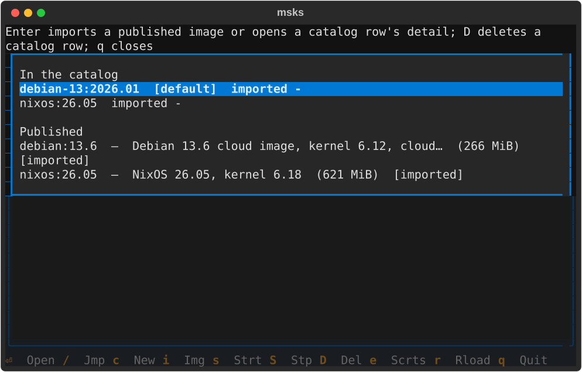

`i`: the image page. Its catalog group comes first, the rows carrying the
default marker and each import's date; then the published channel's rows with
their descriptions, sizes, and membership markers. `[imported]` marks a row
whose archive the catalog holds (an exact hash match); `[in catalog, other
build]` marks one whose ref it holds under a different hash. 

Enter imports a published row through the daemon's URL import or opens a
catalog row's detail.

`D` deletes a catalog row through a confirm, the same DELETE `msks image rm`
makes. The page re-reads the workspace each second, so the dimming follows a
start or stop made anywhere, not only on the page. A workspace the listing no
longer sees — removed from another surface — closes its page and names the
removal on the list's status line.

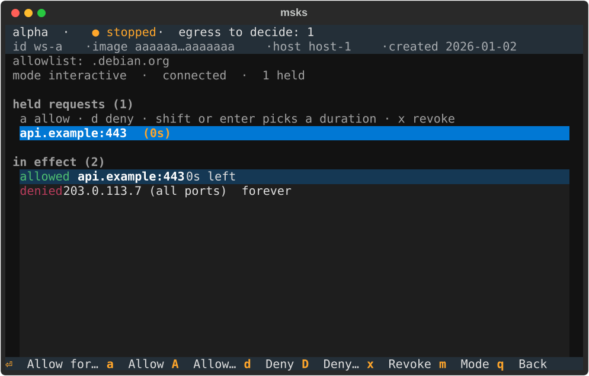

The page's **Egress** action and its `e` key open the egress
consent page: a full-screen visit holding the held-request
queue and the in-effect verdicts together. It is the consent
decider as a page inside the tree, and the only place
verdicts are made.

The page carries the same two-line header as the workspace
page beneath it: the workspace's name with its status (and the
pending-hold count while any hold waits), then the id, image
hash, host, and created date muted. The workspace's identity
stays visible while verdicts are made.

Keys on the page: the arrows navigate the held requests and
cross into the verdict rows beneath (and back). `a`/`d` allow
or deny the focused hold for the default duration
(`tilrestart`); `A`/`D` pick a duration first (`once / 5m /
15m / tilrestart / forever`). The letters act on the holds
alone, and a mis-zoned press names the zone it acts on instead
of deciding silently. `x` revokes the focused verdict (the row
leaves on the daemon's refreshed frame, never optimistically).

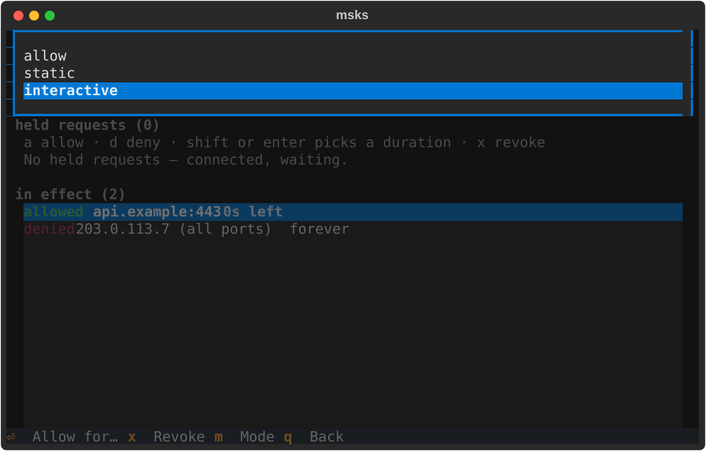

`m` opens the mode picker (`allow` / `static` / `interactive`,
the current mode highlighted), the switch's one path since the
workspace page's own mode action left. Picking a mode switches
the posture through the same endpoint `msks egress mode`
speaks, without leaving the page.
The status line names the new mode as the switch lands. A
pick of `static` with nothing effectively allowed asks the
same offline-workspace confirmation the CLI asks (confirm to
switch, decline to decide nothing). A refused switch names its
reason on the status line, where the operator reads it.

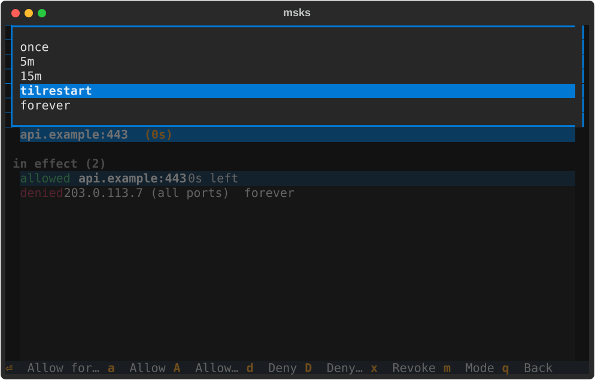

Enter on a focused hold opens the duration picker: the key answers, the pick
decides, and only an explicit letter or a picked duration ever decides. While
no hold waits, the verdict keys stand inert and leave the footer until one
lands. See [`msks egress`](cli.md#msks-egress) for what verdicts and rules
cover.

The page's **Edit settings** action opens the edit
dialog: the create form's own layout, seeded with the
workspace's current values. 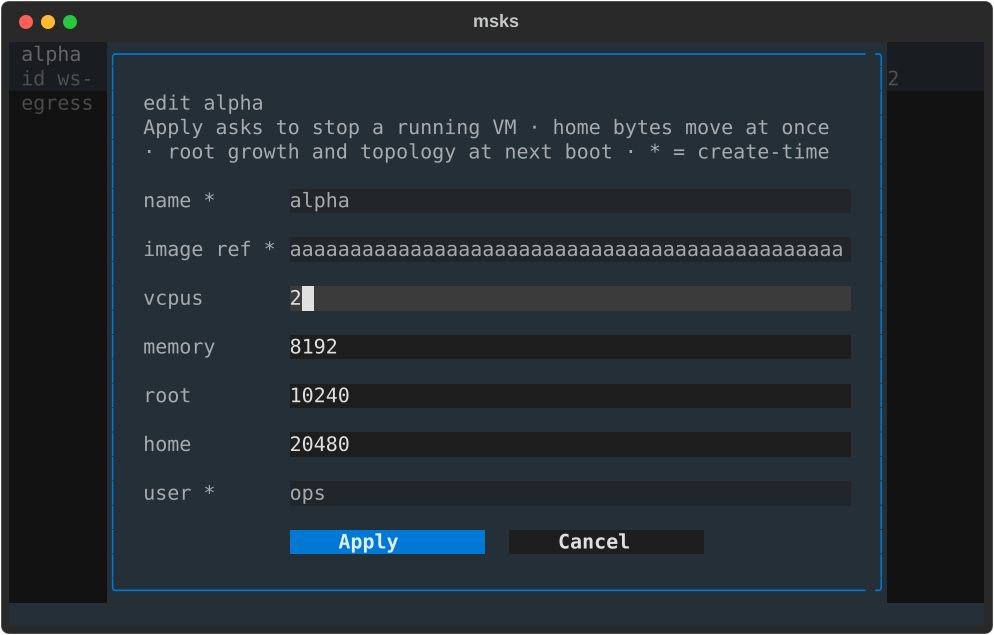

The sizes and topology (root, home, vcpus, memory) are
editable. A submit sends the changed values through the same
endpoint `msks resize` speaks, and the page's consent line
carries the same outcome line the CLI prints, including what
waits for the next boot.

A workspace that is running when Apply lands asks first: confirm and the page
stops the workspace, then applies the resize — decline and the workspace keeps
running with its sizes as they were. Home bytes move at once, and root growth
and the new topology apply at the next boot; a resize the daemon still refuses
— a root shrink, among them — names its reason on the consent line. The name,
image, and user fields show their current values read-only, marked `*` as
create-time — changing them is a delete-and-recreate, and the dialog refuses a
changed value with a note naming the field instead of accepting it silently. A
size left blank keeps its current value. Escape closes the dialog and decides
nothing.

The page's **Open a shell** action runs `msks ssh` in the TUI's own terminal:
the tree exits, the ssh session runs where it stood, and the tree restarts when
the session hands the terminal back. It rides ssh rather than the console
because the console keeps the getty's geometry while ssh carries every resize
to the guest. A workspace ssh cannot reach (no NIC, no identity configured)
takes a longer path. The flow boots a stopped workspace first (the ssh session
it runs boots it itself) and probes the forward. A probe that names the refusal
(no NIC, the service not listening) falls back to a `msks console` session one
step later, and the tree's first flash carries why ssh stood down.

An ssh that ran reports only its exit code, 255 included: ssh hands a session's
own exit through unchanged, and a console after a finished session is a
surprise, not a fallback. The action runs on a stopped workspace too: the ssh
session boots the workspace itself (it carries the workspace's id, and reads
the pre-flight's `msks: <id> is stopped; starting it`).

A host that wants shells in windows beside the running tree
configures a terminal launcher (`terminal_open_cmd` below).
The action then spawns the launcher with a `msks ssh`
invocation appended, and the spawned shell inherits the tree's
resolved connection, so it reaches the same daemon. A launcher that cannot
start — a missing binary, one without the execute bit — names its
reason on the tree's first flash and the shell runs in this
terminal instead: a chained `msks console` session.

Every screen is navigable with arrow keys. Lists move with up/down, the create
form's fields move with up/down between them, and Escape leaves the screen it
is on. `q` backs out of a page; at the workspaces list, Escape is the tree
itself quitting. Ctrl+Q exits the client from any screen (the tree, a page, a
form field, or a panel stacked over them), the same clean exit `q` takes at the
workspaces list.

## The shell action's terminal settings

The workspace page's **Open a shell** action runs `msks ssh` —
in the TUI's own terminal by default, or in a new window
through a configured launcher. Two client settings shape those
windows; their environment-variable rows sit in
[the client environment table](cli.md#client-environment), and
their file keys are documented here.

## `terminal_open_cmd`

`terminal_open_cmd` names the launcher the workspace page's
**Open a shell** action uses to open workspace shells in new
terminal windows; it is the opt-in for hosts that want windows
beside the running tree. The msks invocation is appended after
it, the way most terminals take a command after `-e` /
`--`:

```yaml
terminal_open_cmd: konsole -e          # string form (shell-split)
terminal_open_cmd:                     # list form (no shell quoting)
  - alacritty
  - -T
  - msks ssh
  - -e
```

`terminal_open_cmd`'s environment form
(`MSKSC_TERMINAL_OPEN_CMD`) overrides the file value with the
string form. Unset (the default), the shell action runs `msks ssh` in the
TUI's own terminal, on every host, with no terminal to launch.
A configured launcher that fails to execute (a binary that is
missing or not executable) names its reason on the tree's
first flash after the same-terminal shell ends, and the shell
runs in the same terminal.

## `terminal_title`

`terminal_title` names the title of every terminal window the
workspace page's shell action opens through a configured
launcher. `{workspace}` resolves to the workspace's id, the
token `msks ssh` addresses (that is what the TUI appends to
the launcher), or to `shell` when the appended command names
no workspace:

```yaml
terminal_title: msks — {workspace}
```

Two paths write it. A launcher that runs `msks-term-popup`
writes the title before it attaches tmux, and the launch's own
tmux server pins `set-titles` off, so the title stays for the
window's lifetime — a workspace shell inside the window cannot
rewrite it. Every other launcher gets the title from the
appended `msks ssh` itself: the window msks opens is marked at
spawn, and the command names it before the session starts. A
workspace that sets its own title from inside the session (a
`PROMPT_COMMAND` with a title escape, the way stock ssh sessions
can) rewrites it there — tmux shields the popup path, and nothing
shields the plain path.

`terminal_title`'s environment form (`MSKSC_TERMINAL_TITLE`)
overrides the file value. The default is
unset: the terminal emulator's own title — the command it runs,
or whatever its `-T` / `--title` flag names — stays in place.
A `msks ssh` you type yourself keeps your terminal's title: the
setting applies to the windows msks opens, and a same-terminal
shell (the dead-launcher fallback) changes nothing.

## `msks-term-popup`: the consent-decider terminal

`msks-term-popup` is a shipped client command that runs the
appended shell inside a local tmux session and answers the
workspace's egress consent prompts right there. The launch
also starts the consent-decider app in a hidden tmux session
on the same socket, where it holds the workspace's decider
registration for the window's whole life. 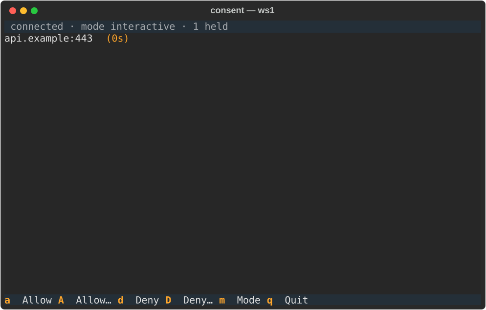

The app lists every hold the workspace carries, destination
and time remaining per row, with the arrow keys moving the
selection. `a` allows until restart and `d` denies the
selected hold, while the uppercase twins `A` and `D` pick a
duration for their verdict (Enter picks, Escape cancels). `m` switches the workspace's egress mode. The picker offers
`allow`, `static`, and `interactive` with the current mode
highlighted (Enter picks, Escape or `q` cancels), and picking
`static` while nothing is effectively allowed asks the
empty-static question first, the same confirmation the consent
page asks. The switch goes through the same endpoint `msks egress mode`
speaks. The status line names the current mode beside the
connection state, and a landed switch flashes its effect there
(`in effect now`, or `takes effect at next start` for a
stopped workspace). A switch the daemon refuses names its
reason on the same line. A hold leaves the
list the moment the daemon resolves it — a verdict from another
decider window or the hold's own timeout — and the popup viewer
hides itself when the list empties.

A hold arriving with the popup closed raises a popup viewer
over the shell that attaches to the hidden session, and the
bindings map rides the popup's bottom edge: the verdict keys,
the mode switch, and the hide/show entry. `q`, `Esc`, or `C-b`
hide the viewer
— the decider keeps running, its queue keeps living, and `C-b p`
brings the popup back; a popup the app raised returns the same
way on the next hold. The session ends with its window, and the
decider registration ends with the server. It works with any
terminal that runs a command: name your terminal and its command
flag in `terminal_open_cmd`, and `msks-term-popup` right after it
(tmux 3.2 or newer must be on PATH):

```yaml
terminal_open_cmd: konsole -e msks-term-popup
terminal_open_cmd: xterm -e msks-term-popup
terminal_open_cmd:                     # list form (no shell quoting)
  - alacritty
  - -T
  - msks ssh
  - -e
  - msks-term-popup
```

The popup viewer keeps its own attach to the hidden session,
so a hold that arrives while it stands is already in the
list. Verdicts posted from it land through the same REST
contract as the consent page. A post that cannot land (the
request resolved in another decider window while the verdict
was in flight) names its reason on the popup's status
line. The window the prefix
opens takes its title from
`terminal_title` (`msks — {workspace}` resolves the workspace's
id into it). The session's own status bar names the workspace too. The launch resolves the workspace's name and pins it to the
status bar's left side (`[project-x]`). The id stands in
whenever the lookup cannot land (the daemon down, the
workspace gone, the wait run out), and `shell` stands for a
plain shell. The window list after the label stays empty, and so
does the bar's right side, which tmux's default fills with the
pane's title, the clock, and the date: the label is the whole
bar.
The hidden consent session runs on the launch's own socket,
one small server per window, and the app retires when the
window has been gone for a stretch, taking the session and the
server with it. The window's own hold flags (`konsole --hold`,
xterm's `-hold`) keep the window open after the session ends,
as they do for a plain shell window.

The pane keeps 10000 lines of scrollback and takes the mouse
wheel: wheel up scrolls into the pane's history, wheel down
scrolls back toward the live output, and reaching the bottom
(or pressing `q`) returns to the plain shell. The keyboard path
covers the same history: `Ctrl-b [` (or `Ctrl-b PageUp`) opens
tmux's copy mode, where the arrow keys and PageUp/PageDown move
through it. `Shift-PageUp` and `Shift-PageDown` page through it too, one
page per press, entering copy mode on the way up and returning
to the shell at the bottom. A terminal that keeps the shifted pair for its own view still
has the wheel, because its scrollback has nothing to show on
this pane. Konsole can hand the pair to the pane with a
keytab rule scoped to the alternate screen, sending
`\E[5;2~` and `\E[6;2~`. The bare
PageUp/PageDown reach the shell untouched. These settings — the
status bar's name among them — ride
the window's own tmux server (the
launch's dedicated socket); an operator's own running tmux server
keeps its own settings. With tmux's mouse mode on, a plain drag
selects text in tmux's buffer, and holding Shift while dragging
selects the terminal's native text (most terminals hand Shift
drags to their own selection). A consent popup raised while the
pane is scrolled still takes its verdict keys: the popup overlays
the scrolled pane, and the next keypress answers it.
